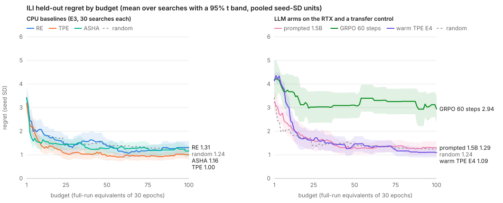

# Ablations, robustness and external validity

Generated by scripts/ablations/report.py from results/ablations/*.json. Do not edit by hand. Registered in docs/prereg_ablations.md (AB1, AB3 and AB5 on this branch; AB2 and Soumitra's AB4, 15db163, on origin/soumitra-leg2; Diya's AB4, 2ab2996, on main); every result here is secondary to the primary endpoints, and none is a claim under CLAUDE.md rule 6. Regret is in pooled seed-SD units unless stated; lower is better. Intervals are 95% t intervals (Welch for differences), unadjusted, beside Holm-adjusted p where a family is tested, unless a section names a bootstrap interval (AB-R, the robust checks). ILI regret is scored on seeds the search never saw; ETTh1 has one seed per config, so ETTh1 replays are in-sample, no claim. These numbers describe the replay table (every lookup returns a recorded training run), not live training: E3b's K7 check of the table against live training failed on ILI, so they hold for the table only.

## At a glance

* Scope of everything below: Replay table only (E3b's K7 failed on ILI; see the header). Every test here is secondary to the primary endpoints and none is a claim under CLAUDE.md rule 6 (Welch t intervals and permutation p, no paired block-bootstrap interval, no gate). ETTh1 values are in-sample (one seed per config), so no claim rests on them.
* Noise-free lookups: searching and scoring on the same 3-seed means, TPE beats random by -0.34 SD in AUC (91% of seed pairs); with E3's noisy lookups its held-out gap is -0.38 SD (72%). So removing noise does not widen TPE's margin. With lookups from two seeds scored on the third, TPE's difference per held seed is -0.16, +0.05, -0.05 SD (interval over search seeds only; by budget 100 its 30 runs hold few distinct configs; the in-sample gap of the same hold-out runs is -0.39 SD). AB-Q neither supports nor refutes that seed noise explains the null on fresh seeds. (AB-Q; the hold-out is exploratory)
* The nulls have limited resolution. At budget 50 the pick reseeds could detect differences of 0.89 to 1.34 SD on ILI and, in robust-SD units, 1.72 to 2.04 on ETTh1 (80% power, Holm size in the table); the observed non-significant differences are 4% to 41% of that. E4's ILI nulls (league against the portfolio and against no league, 10 policies) could detect 1.10 to 1.25 SD by the registered normal approximation, and 1.25 to 1.38 SD with t quantiles (descriptive). The one E4 comparison that rejects, league vs tpe_warm_from_ETTh1, is a loss, not a null: the league is +1.50 SD worse. (ST)
* External HPO baselines: none of the 3 is rejected against random search on ILI after Holm; the closest is smac vs random (-0.24 SD, Holm p 0.16), and effects below about 0.40 SD are not excluded. DEHB is handicapped: 69% of its proposals were infeasible or repeated and were replaced (AB-X).
* Controller ablations: none of the 3 league settings is rejected against the reference; the test could detect about 0.23 SD (AB-C).
* Registered LLM ablations on Soumitra's RTX (AB2; Soumitra's AB4, 15db163), Anirudh's independent computation, complete; not of record: the computation of record named by Diya's AB4 (2ab2996), LLM-registered.json, is not yet computed. A verifier recomputed these values independently and they agree (docs/verdicts/ablations_rtx_reviews.md). Secondary tests, not claims under CLAUDE.md rule 6.
  * Steps (AB-G): no dose-response is detected across 30, 60 and 120 steps (30 steps 3.03, 60 steps 3.26, 120 steps 3.17 SD; per-policy sign-flip p 1.000, analysis (ii)). Policies trained on ETTh1 are +1.59 SD [+1.28, +1.90] worse on ILI than the untrained model (Welch t 95%, unadjusted; permutation p < 0.0001, analysis (i); (i) and (ii) are registered secondary in Diya's AB4, 2ab2996, and exploratory in Soumitra's, 15db163). The registered step trend (rho +0.76, Holm p < 0.0001, rejected) is reported as registered, with a p that is anti-conservative because the levels are nested (the trained levels share seeds and are prefixes of each other up to GPU nondeterminism).
  * Scale (AB-P): on ILI, for these three Qwen2.5 checkpoints and this prompt, a larger model gave a higher, that is worse, AUC (0.5B 1.39, 1.5B 1.56, 3B 2.06 SD; rho +0.43, Holm p < 0.0001, rejected, could detect |rho| of about 0.33); size is not isolated. On ETTh1 (in-sample, no claim) the order by AUC is 3B 1.32, 0.5B 1.42, 1.5B 1.47.
  * Anonymised prompt (AB-P): on ILI, for this prompt, +0.36 SD [+0.10, +0.63] against ref (Welch t 95%, unadjusted; Holm p 0.0145, rejected within AB-P; over all 13 registered ablation tests, exploratory and post hoc, Holm p 0.0800, not rejected). The arm renames the fields and drops their descriptions, which also changes the decoding trie, so it does not isolate prior knowledge of the names. On ETTh1 (in-sample, no claim) anon 1.37 against ref 1.47.
  * Repair (AB-P): +0.03 SD [-0.28, +0.33] against ref (Welch t 95%, unadjusted; Holm p 0.8614, not rejected); it decodes without the constraint, and 53% of its proposals were over the parameter cap and replaced by the nearest feasible unseen config, so it measures that combination.
  * KL weight (AB-G): ILI held-out AUC beta 0 3.40, beta 0.04 3.26, beta 0.1 3.09 SD (rho -0.17, Holm p 0.3745, not rejected, could detect |rho| of about 0.53).
* Exploratory, post hoc (Holm over 180 comparisons): no LLM arm (prompted or GRPO, any card) beats random, regularized evolution, TPE, ASHA, random + referee on ILI held-out AUC, even by an unadjusted interval; on unadjusted intervals only, prompted Qwen 0.5B (RTX), prompted Qwen 1.5B repair (Mac) lie below PG controller; prompted Qwen 1.5B repair (Mac) lies below PG controller, league rivals (A4); prompted Qwen 0.5B (RTX), prompted Qwen 1.5B repair (Mac) lie below prompted Qwen 1.5B (E3, A10); prompted Qwen 0.5B (RTX), prompted Qwen 1.5B repair (Mac) lie below warm-started TPE from ETTh1 (E4), and none of these survives Holm; after Holm the only baselines an arm beats are portfolio from ETTh1 (E4), each time by an untrained prompted arm, which searches ILI directly and is not the arm that transfer control is matched to; 101 comparisons are Holm-rejected in the baseline's favour (87 with a GRPO arm, 14 with a prompted arm). The GRPO-trained arms are worse than the untrained prompted model (AB-G). The GRPO evidence is transfer between two tables (ETTh1 to ILI); within-table GRPO was dropped (docs/PLAN.md A12, A18). The CPU baselines search ILI directly, so they have a different information set; only the E4 portfolio and warm-started TPE are the registered transfer controls.
* Prompted Qwen on the Mac (exploratory; unadjusted 95% intervals, none is rejected after Holm): anon vs ref +0.31 SD [-0.01, +0.62], Holm p 0.117; repair vs ref -0.33 SD [-0.63, -0.03], Holm p 0.080; on ETTh1 (in-sample, no claim) the signs reverse: anon vs ref -0.13, repair vs ref +0.28 (AB-P).
* GRPO training on the Mac (exploratory): ten league policies trained on ETTh1 are +1.24 SD [+0.93, +1.54] worse on ILI than the untrained model (post hoc; all 10 worse than the same-seed untrained search). Trained policies look up RevIN-off configs 98% of the time on ILI (untrained 55%; the best RevIN-off ILI config has regret 1.03 SD), which is consistent with a source-table preference that does not transfer; it is not evidence that GRPO or the league is harmful, and the cause is not tested. No dose effect is detected among 30, 60 and 120 steps (sign flip p 0.70). The registered step-trend statistic is rho +0.71 on these runs, but its p is not valid (dependent checkpoints), so it is not a rejection (AB-G).
* The registered AB-L rejection (ETTh1 source, Holm p 0.031) rests on a test that is too liberal (false-positive rate 0.36 and 0.18 at the 0.025 level for a model that never learns, from a null of ten searches per table; from thirty Mac searches (exploratory) 0.24 on ETTh1 and 0.09 on ILI); an exploratory, post hoc position-adjusted test agrees: exact sign flip of the 10 adjusted ETTh1 slopes p 0.014 (uncorrected; Holm over the two tables 0.027). On the ILI source no trend was detected (registered Holm p 0.400; adjusted p 0.53). The ETTh1 reward is in-sample (one seed per config), so no claim rests on it. The no-league arm's ETTh1 slope is +0.247, at least as large, so nothing here says the league did it (AB-L).
* The referee's skill on ILI comes mostly from the config fields: tau 0.61 from fields alone, 0.30 from curves alone, 0.57 from both, against the 3-seed mean. That target contains the seed-2021 value the referee is trained on; against the mean of the other two seeds the same three are 0.50, 0.25 and 0.46 (AB-R).
* The two tables show no detectable agreement on which fields matter (Spearman 0.14 between marginal field shares, 0.26 between exploratory conditional shares, 8 fields); RevIN explains 84% of ETTh1's variance and 5% of ILI's, and its ETTh1 validation advantage for RevIN off does not shrink from 30 to 100 epochs (that comparison also changes patience from 10 to 100, RQ3; ETTh1 in-sample, no claim).
* Compute (descriptive): recorded hours per card, summed from the run and training records: Apple M4 Pro (MPS) search 5.4 h; Apple M4 Pro (MPS) training 3.8 h; NVIDIA A10 search 1.3 h; NVIDIA A10 training 10.1 h; NVIDIA A10 training, superseded (A25), never deployed, compute only 2.3 h; NVIDIA A10G search 1.1 h; NVIDIA A10G training 8.1 h; NVIDIA A10G training, superseded (A25), never deployed, compute only 1.1 h; NVIDIA GeForce RTX 4080 Laptop GPU search 10.1 h; NVIDIA GeForce RTX 4080 Laptop GPU training 18.5 h. Equal target epochs are not equal compute: GRPO also trained on the source table, and the CPU replays record no time (Compute section).

## AB-Q: noise-free lookups (descriptive, CPU)

Every lookup returns the 3-seed mean, and regret is scored on the same means. 59 of 2368 configs lie within one seed SD of the best mean and 282 within two. The last two columns are the share of seed pairs in which the method beats random search: with seed noise (E3, held out) and without it. Replay table only (E3b's K7 failed on ILI; see the header). Source: scripts/ablations/plateau.py at d8364cd82874 (script sha256 2581544b1c87).

| method | noise-free AUC | E3 AUC, noisy | noise-free @10 | noise-free @25 | noise-free @50 | noise-free @100 | P(beats random), noisy | P(beats random), noise-free |
|---|---|---|---|---|---|---|---|---|
| tpe | 0.45 [0.40, 0.50] | 1.14 | 1.15 | 0.43 | 0.25 | 0.15 | 0.72 | 0.91 |
| re | 0.57 [0.50, 0.64] | 1.47 | 1.35 | 0.66 | 0.36 | 0.12 | 0.51 | 0.76 |
| referee | 0.57 [0.50, 0.64] | 1.22 | 1.02 | 0.68 | 0.43 | 0.23 | 0.67 | 0.76 |
| asha | 0.60 [0.55, 0.66] | 1.38 | 0.90 | 0.60 | 0.46 | 0.34 | 0.57 | 0.72 |
| pg_league | 0.69 [0.61, 0.78] | 1.59 | 1.53 | 0.74 | 0.47 | 0.24 | 0.43 | 0.61 |
| epochk | 0.72 [0.66, 0.78] | 1.50 | 1.08 | 0.80 | 0.60 | 0.43 | 0.51 | 0.58 |
| pg_uniform_rivals | 0.72 [0.64, 0.80] | 1.61 | 1.53 | 0.88 | 0.53 | 0.24 | 0.44 | 0.56 |
| pg | 0.76 [0.67, 0.84] | 1.69 | 1.53 | 1.03 | 0.55 | 0.24 | 0.42 | 0.54 |
| random | 0.79 [0.70, 0.88] | 1.52 | 1.35 | 0.85 | 0.69 | 0.47 | 0.50 (itself) | 0.50 (itself) |
| pg_league_charged | 0.89 [0.80, 0.97] | 1.77 | 1.60 | 1.04 | 0.72 | 0.38 | 0.36 | 0.38 |

The noise-free table is searched and scored on the same 3-seed means, so a method that fits the remaining noise of those means is rewarded for it; a gap here is not evidence of a gap on fresh seeds (the pick reseeds are). Left out: prompted Qwen (GPU); see AB-Q-mps if it was run.

Hold-out check (exploratory, AB3 addendum): lookups are the mean of two seeds and the search's incumbent is scored on the third, each seed held out in turn; search seed, AUC averaged over the three held-out seeds (the interval resamples search seeds only). Held seeds 2021, 2022, 2023.

Held-out AUC is measured from the best config at the held seed, so it is not comparable with the noise-free and E3 columns above.

| method | held-out AUC | difference from random | t interval over the 3 hold-outs (2 df) | difference per held seed | in-sample difference of the same runs | distinct configs in 30 final picks (per held seed) | P(beats random), run level |
|---|---|---|---|---|---|---|---|
| referee | 2.17 [2.07, 2.27] | -0.15 [-0.29, -0.01] | -0.34 to +0.04 | -0.23 / -0.08 / -0.14 | -0.24 | 12 / 12 / 11 | 0.58 |
| asha | 2.19 [2.05, 2.32] | -0.13 [-0.30, +0.03] | -0.58 to +0.31 | -0.01 / -0.34 / -0.05 | -0.17 | 12 / 12 / 9 | 0.57 |
| pg_uniform_rivals | 2.22 [2.11, 2.34] | -0.10 [-0.27, +0.08] | -0.39 to +0.19 | +0.03 / -0.20 / -0.12 | -0.04 | 11 / 12 / 13 | 0.57 |
| epochk | 2.25 [2.11, 2.38] | -0.07 [-0.22, +0.08] | -0.45 to +0.31 | +0.04 / -0.25 / -0.01 | -0.10 | 14 / 17 / 17 | 0.57 |
| tpe | 2.27 [2.18, 2.36] | -0.05 [-0.22, +0.12] | -0.31 to +0.21 | -0.16 / +0.05 / -0.05 | -0.39 | 9 / 3 / 8 | 0.49 |
| pg_league | 2.29 [2.13, 2.44] | -0.03 [-0.26, +0.19] | -0.24 to +0.17 | -0.05 / -0.10 / +0.06 | -0.09 | 13 / 12 / 12 | 0.46 |
| random | 2.32 [2.17, 2.47] | 0 (itself) |  |  | 0 (itself) | 18 / 19 / 22 | 0.50 (itself) |
| re | 2.35 [2.22, 2.47] | +0.03 [-0.13, +0.18] | -0.39 to +0.44 | -0.03 / +0.22 / -0.10 | -0.26 | 6 / 4 / 8 | 0.47 |
| pg | 2.38 [2.25, 2.52] | +0.06 [-0.12, +0.24] | -0.07 to +0.20 | +0.12 / +0.01 / +0.06 | -0.01 | 12 / 11 / 14 | 0.41 |
| pg_league_charged | 2.41 [2.27, 2.54] | +0.09 [-0.10, +0.27] | -0.15 to +0.33 | +0.19 / +0.01 / +0.05 | +0.09 | 19 / 15 / 17 | 0.42 |

The hold-out scores one seed and cuts lookups to two, so its per-seed differences are noisy; its interval resamples search seeds only, while the runs share the same three seeds of every config.

Prompted Qwen on the same noise-free table (Mac, exploratory, 30 seeds): AUC 0.95 [0.83, 1.06].

## AB-X: external HPO baselines (tested, CPU)

SMAC3 2.4.1, DEHB 0.1.2, ConfigSpace 1.2.2 through the E3 oracle; 30 seeds; tested on ILI against E3's random search. Replay table only (E3b's K7 failed on ILI; see the header). Source: scripts/ablations/external_hpo.py at 7a6795426d73 (script sha256 e3862c23d963).

ILI:

| method | AUC (t 95%) | AUC, raw validation MSE (t 95%) | @10 | @25 | @50 | @100 |
|---|---|---|---|---|---|---|
| tpe | 1.14 [1.02, 1.25] | 0.01113 [0.00999, 0.01226] | 1.38 [1.09, 1.68] | 1.07 [0.82, 1.32] | 0.95 [0.76, 1.14] | 1.00 [0.83, 1.18] |
| smac | 1.27 [1.12, 1.42] | 0.01246 [0.01100, 0.01393] | 1.73 [1.33, 2.12] | 1.35 [1.00, 1.69] | 1.02 [0.81, 1.22] | 1.00 [0.80, 1.20] |
| hyperband | 1.51 [1.28, 1.74] | 0.01478 [0.01253, 0.01702] | 1.64 [1.25, 2.03] | 1.43 [1.11, 1.74] | 1.32 [1.00, 1.63] | 1.37 [1.08, 1.66] |
| random | 1.52 [1.31, 1.72] | 0.01483 [0.01284, 0.01682] | 2.07 [1.64, 2.50] | 1.39 [1.08, 1.70] | 1.42 [1.20, 1.63] | 1.24 [1.03, 1.45] |
| dehb | 1.53 [1.35, 1.72] | 0.01502 [0.01320, 0.01685] | 1.86 [1.53, 2.19] | 1.65 [1.28, 2.01] | 1.37 [1.14, 1.60] | 1.30 [1.04, 1.56] |
| dehb_vector | 1.61 [1.35, 1.87] | 0.01578 [0.01322, 0.01834] | 1.72 [1.32, 2.13] | 1.88 [1.52, 2.24] | 1.50 [1.20, 1.81] | 1.33 [1.06, 1.61] |

| test | seeds | difference (SD units; Welch t 95%, unadjusted) | p | p, Holm | rejected | detectable at 80% |
|---|---|---|---|---|---|---|
| dehb vs random | 30 / 30 | +0.020 [-0.250, +0.290] | 0.8843 | 1.0000 | no | 0.44 |
| hyperband vs random | 30 / 30 | -0.005 [-0.305, +0.295] | 0.9727 | 1.0000 | no | 0.49 |
| smac vs random | 30 / 30 | -0.242 [-0.489, +0.006] | 0.0527 | 0.1581 | no | 0.40 |

Share of proposals replaced by the repair rule: dehb 69%, dehb_vector 38%, hyperband 0%, smac 0%.

Exploratory (AB3 addendum 2): DEHB with the evaluated config's vector stored in its population, against random: dehb_vector vs random +0.097 [-0.227, +0.422], p 0.554.

ETTh1 (in-sample, no claim; descriptive):

| method | AUC (t 95%) | AUC, raw validation MSE (t 95%) | @10 | @25 | @50 | @100 |
|---|---|---|---|---|---|---|
| tpe | 1.37 [1.23, 1.51] | 0.01807 [0.01623, 0.01991] | 1.58 [1.34, 1.81] | 1.19 [0.96, 1.41] | 1.17 [0.96, 1.38] | 1.18 [0.99, 1.36] |
| smac | 1.50 [1.35, 1.66] | 0.01983 [0.01778, 0.02188] | 2.03 [1.77, 2.29] | 1.39 [1.13, 1.65] | 1.31 [1.09, 1.53] | 1.33 [1.07, 1.59] |
| hyperband | 1.51 [1.41, 1.62] | 0.02000 [0.01856, 0.02144] | 1.63 [1.30, 1.95] | 1.27 [1.03, 1.52] | 1.32 [1.19, 1.45] | 1.39 [1.23, 1.56] |
| random | 1.61 [1.41, 1.80] | 0.02121 [0.01867, 0.02375] | 1.91 [1.57, 2.24] | 1.46 [1.16, 1.76] | 1.53 [1.12, 1.94] | 1.51 [1.22, 1.80] |
| dehb | 1.63 [1.50, 1.77] | 0.02155 [0.01977, 0.02333] | 1.83 [1.29, 2.37] | 1.66 [1.42, 1.89] | 1.49 [1.29, 1.70] | 1.35 [1.19, 1.52] |
| dehb_vector | 1.69 [1.44, 1.93] | 0.02226 [0.01902, 0.02550] | 2.07 [1.50, 2.64] | 1.76 [1.31, 2.22] | 1.47 [1.20, 1.74] | 1.45 [1.18, 1.72] |

Share of proposals replaced by the repair rule: dehb 71%, dehb_vector 42%, hyperband 0%, smac 0%.

Choices a SMAC or DEHB user would question: SMAC starts from 10 random configs (its default is a Sobol design), refits after every trial (default 8), and maximises EI over all unevaluated configs; every field is an unordered categorical (the numeric fields are ordinal); SMAC sees a deterministic objective, the one seed value the search run draws, which is the same noise E3's methods see. Hyperband and DEHB screen at one epoch, whose ranking agrees with the final value only weakly (E2: tau at k = 1 is in AB-R). SMAC and Hyperband never repair; DEHB does.

## AB-C: factorized-controller ablations (tested, CPU)

League rivals, 100 search seeds per arm; held-out AUC regret on ILI in pooled seed-SD units; lower is better. Replay table only (E3b's K7 failed on ILI; see the header). Source: scripts/ablations/controller.py at d632c418e401 (script sha256 eabd7e237483).

ILI:

| arm | AUC (t 95%) | AUC, raw validation MSE (t 95%) | @10 | @25 | @50 | @100 |
|---|---|---|---|---|---|---|
| ref | 1.51 [1.42, 1.60] | 0.01479 [0.01386, 0.01571] | 2.17 [1.94, 2.40] | 1.62 [1.44, 1.81] | 1.33 [1.16, 1.49] | 1.09 [0.97, 1.21] |
| rivals_8 | 1.53 [1.44, 1.62] | 0.01497 [0.01407, 0.01586] | 2.17 [1.94, 2.40] | 1.68 [1.48, 1.89] | 1.38 [1.23, 1.52] | 1.12 [0.98, 1.26] |
| snapshot_1 | 1.56 [1.46, 1.66] | 0.01527 [0.01430, 0.01625] | 2.17 [1.94, 2.40] | 1.78 [1.58, 1.98] | 1.39 [1.23, 1.55] | 1.11 [0.99, 1.23] |
| rivals_1 | 1.58 [1.48, 1.68] | 0.01546 [0.01446, 0.01645] | 2.17 [1.94, 2.40] | 1.68 [1.49, 1.87] | 1.45 [1.27, 1.63] | 1.25 [1.12, 1.39] |

| test | seeds | difference (SD units; Welch t 95%, unadjusted) | p | p, Holm | rejected | detectable at 80% |
|---|---|---|---|---|---|---|
| rivals_1 vs ref | 100 / 100 | +0.069 [-0.069, +0.206] | 0.3289 | 0.9867 | no | 0.23 |
| rivals_8 vs ref | 100 / 100 | +0.019 [-0.112, +0.149] | 0.7796 | 0.9867 | no | 0.21 |
| snapshot_1 vs ref | 100 / 100 | +0.050 [-0.087, +0.186] | 0.4752 | 0.9867 | no | 0.22 |

ETTh1 (in-sample, no claim; descriptive, one seed per config):

| arm | AUC (t 95%) | AUC, raw validation MSE (t 95%) | @10 | @25 | @50 | @100 |
|---|---|---|---|---|---|---|
| rivals_1 | 1.29 [1.23, 1.35] | 0.01707 [0.01629, 0.01786] | 1.32 [1.16, 1.48] | 1.12 [1.02, 1.23] | 1.17 [1.06, 1.27] | 1.21 [1.14, 1.28] |
| snapshot_1 | 1.33 [1.26, 1.40] | 0.01757 [0.01667, 0.01847] | 1.32 [1.16, 1.48] | 1.19 [1.07, 1.31] | 1.22 [1.13, 1.32] | 1.25 [1.18, 1.32] |
| rivals_8 | 1.34 [1.27, 1.40] | 0.01764 [0.01677, 0.01852] | 1.32 [1.16, 1.48] | 1.20 [1.08, 1.31] | 1.19 [1.11, 1.28] | 1.23 [1.17, 1.30] |
| ref | 1.35 [1.28, 1.43] | 0.01783 [0.01685, 0.01882] | 1.32 [1.16, 1.48] | 1.22 [1.08, 1.36] | 1.28 [1.17, 1.38] | 1.28 [1.18, 1.38] |

## AB-P and AB-G on Soumitra's RTX (AB2 and Soumitra's AB4): Anirudh's independent computation

Status: complete, 10 of 10 tested ILI arms (and 5 ETTh1 tables, descriptive); Anirudh's independent computation, not the result of record (below). AB5 calls it final because the pinned commit is the local tip of origin/soumitra-leg2 as this clone last fetched it (26 Nov 19:40 ET); that does not stop Soumitra from pushing before the deadline, and a new tip would reopen it. Deadlines: 28 Nov 23:59 ET for every arm (AB1, kept by Soumitra's AB4, 15db163), which this computation applies; 28 Nov 18:00 ET for the four AB4 items under Diya's AB4 (2ab2996). Every arm's queue DONE time is before both (timeline below). Registered in AB2 (c2dda8d) and Soumitra's AB4 (15db163), both on origin/soumitra-leg2, under which every arm ran; the scale trend's statistic (Spearman of model-size rank with AUC, two-sided permutation p) was fixed in AB5 (510633d, this branch), after the AB2 runs existed and before Anirudh had seen any AB2 value. Run files read from origin/soumitra-leg2 at e6926d8664b8 (23 files, each with its source, commit and sha256 in results/ablations/LLM-rtx.json; AB2's move manifest matches for 9 of 9 files). Every reference is local to the same card (AB1; Soumitra's AB4, 15db163). ILI held-out AUC, pooled seed-SD units, lower is better. For a trend, positive rho means a higher (worse) AUC at the higher level: more steps, a larger KL weight, a larger model. These are secondary tests, not claims under CLAUDE.md rule 6: the intervals are Welch t and the p values unpaired permutation p, with no paired block-bootstrap interval, and no gate applies (G4 covers E3 and E4 only). Replay table only (E3b's K7 failed on ILI; see the header). Source: scripts/ablations/llm_rtx.py at 1c90bed2afab (script sha256 63e12edf634c).

Verification: a verifier recomputed the AB2 and AB4 values of these families independently, and they agree with this computation and with Soumitra's scripts/ablations/rtx_tests.py (reports in docs/verdicts/ablations_rtx_reviews.md). The raw-MSE column, the per-policy table and the compute totals were added after that check.

Not the result of record. Diya's AB4 (2ab2996, origin/main) names scripts/ablations/llm_registered.py, run once by Soumitra, as the computation of the registered AB-P and AB-G families, writing results/ablations/LLM-registered.json. That file is not yet computed, so the registered families are not yet computed of record. Places checked for it: Diya's AB4 at 2ab2996 (absent); origin/main at 2ab2996 (absent); origin/soumitra-leg2 (pinned) at e6926d8 (absent); this working tree (absent). Soumitra's branch also carries its own scripts/ablations/rtx_tests.py (e6926d8). AB5 (510633d) was committed before Diya's AB4 but reached GitHub after it. The tables below are an independent computation of the same registered tests from the same run files. docs/LEG3_soumitra.md asks Anirudh not to read results/ablations/rtx/ before LLM-registered.json is committed, and not to edit common.py or llm_tests.py until then: the AB2 values here were computed before docs/LEG3_soumitra.md reached this clone, and the AB4 values after it, on Anirudh's decision, as a check. llm_tests.py, which llm_registered.py pins, was changed on this branch in 510633d (26 Nov 17:12 ET) before docs/LEG3_soumitra.md existed (committed on main with Diya's AB4, 26 Nov 17:21 ET); in a692f0e (26 Nov 19:32 ET), f9c0d62 (26 Nov 19:35 ET) after this clone fetched it (26 Nov 19:04 ET), against its request; 943d893 (26 Nov 19:44 ET) restored it byte-identical to main's 08c72a4c. Its sha256 when this computation ran: 08c72a4c.

Two amendments are both headed AB4, and the report names each by its commit. Soumitra's AB4 (15db163, origin/soumitra-leg2), in force when the queue started, registers the anon, repair and step arms, their local references, the tests and the 28 Nov 23:59 ET deadline (llm_rtx.py: REGISTERED_AT, DEADLINE), and runs the policy-level analyses as exploratory. Diya's AB4 (2ab2996, origin/main) names llm_registered.py as the computation of record, makes analyses (i) to (iii) registered secondary, fixes the reading rule for the step result and an 18:00 ET deadline for the four AB4 items. Which one governs each element is for Diya to settle in a dated amendment; this report takes the arms, tests and deadline from 15db163 and the reading rule from 2ab2996.

Timeline (commit times from git; queue lines from results/logs/l4_queue_status.txt and ab4_queue_status.txt at the pinned commit; START lines left out):

| time | event |
|---|---|
| 25 Nov 00:13 ET | AB2 registered (origin/soumitra-leg2): the model-scale and KL arms; commit c2dda8d |
| 25 Nov 00:13 ET | queue started at c2dda8d [l4_queue_status.txt] |
| 25 Nov 00:40 ET | DONE abl_p_ref_local_ILI (rc=0) [l4_queue_status.txt] |
| 25 Nov 01:10 ET | DONE abl_p_05b_local_ILI (rc=0) [l4_queue_status.txt] |
| 25 Nov 02:03 ET | DONE abl_p_3b_local_ILI (rc=0) [l4_queue_status.txt] |
| 25 Nov 02:23 ET | DONE abl_p_ref_local_ETTh1 (rc=0) [l4_queue_status.txt] |
| 25 Nov 02:43 ET | DONE abl_p_05b_local_ETTh1 (rc=0) [l4_queue_status.txt] |
| 25 Nov 03:13 ET | DONE abl_p_3b_local_ETTh1 (rc=0) [l4_queue_status.txt] |
| 25 Nov 06:37 ET | DONE abl_g_ref_local (rc=0) [l4_queue_status.txt] |
| 25 Nov 10:13 ET | DONE abl_g_beta0_local (rc=0) [l4_queue_status.txt] |
| 25 Nov 13:44 ET | DONE abl_g_beta01_local (rc=0) [l4_queue_status.txt] |
| 25 Nov 13:44 ET | queue ended [l4_queue_status.txt] |
| 26 Nov 01:32 ET | Soumitra's AB4 registered (origin/soumitra-leg2): the anon, repair and step arms, local references, the tests, the 28 Nov 23:59 ET deadline, policy-level analyses exploratory; commit 15db163 |
| 26 Nov 01:32 ET | queue started at 15db163 [ab4_queue_status.txt] |
| 26 Nov 01:38 ET | AB4 move of AB2's run files to results/ablations/rtx/ (origin/soumitra-leg2); commit 7fd5085 |
| 26 Nov 02:09 ET | DONE abl_p_anon_local_ILI (rc=0) [ab4_queue_status.txt] |
| 26 Nov 04:01 ET | DONE abl_p_repair_local_ILI (rc=0) [ab4_queue_status.txt] |
| 26 Nov 05:21 ET | INTERRUPTED abl_p_anon_local_ETTh1: laptop shut down unexpectedly (boot 2026-11-26 05:18:33; last record 05:12:25, 21 of 30 seeds, file intact); no ablate_llm.py process running (ps) [ab4_queue_status.txt] |
| 26 Nov 05:21 ET | stale lock: deleted results/runs/llm_local/ABL_P_anon_local/ETTh1_T336/driver.lock (AB2 procedure, AB4); relaunching the queue [ab4_queue_status.txt] |
| 26 Nov 05:21 ET | queue started at 7fd5085 [ab4_queue_status.txt] |
| 26 Nov 05:36 ET | DONE abl_p_anon_local_ETTh1 (rc=0) [ab4_queue_status.txt] |
| 26 Nov 07:19 ET | DONE abl_p_repair_local_ETTh1 (rc=0) [ab4_queue_status.txt] |
| 26 Nov 07:20 ET | AB4 prompted arms' run files committed: anon and repair, ILI and ETTh1 (origin/soumitra-leg2); commit 185a0b1 |
| 26 Nov 11:29 ET | DONE abl_g_steps30_local (rc=0) [ab4_queue_status.txt] |
| 26 Nov 11:29 ET | AB4 ABL_G_steps30_local run and training files committed (origin/soumitra-leg2); commit c7e4bc9 |
| 26 Nov 17:12 ET | AB5 (this branch): this computation and the scale trend's statistic; commit 510633d |
| 26 Nov 17:21 ET | Diya's AB4 (origin/main): llm_registered.py as the computation of record, analyses (i) to (iii) registered secondary, the reading rule, 28 Nov 18:00 ET for the four AB4 arms; commit 2ab2996 |
| 26 Nov 18:25 ET | DONE abl_g_steps120_local (rc=0) [ab4_queue_status.txt] |
| 26 Nov 18:25 ET | queue ended [ab4_queue_status.txt] |
| 26 Nov 18:25 ET | AB4 ABL_G_steps120_local run and training files and the AB4 queue status file committed (origin/soumitra-leg2); commit e880b0a |
| 26 Nov 18:44 ET | 'Results' commit, the pinned tip of origin/soumitra-leg2: duplicate copies of the run files under results/runs/llm_local/, scripts/ablations/rtx_tests.py and its tests, copies of common.py and llm_tests.py, and the lock file results/logs/l4_queue.lock; no AB4 run file is new in it; commit e6926d8 |
| 26 Nov 19:40 ET | this clone last fetched origin/soumitra-leg2 |
| 26 Nov 20:53 ET | this computation |

Disclosure fixed by Diya's AB4 (2ab2996), quoted verbatim: "The RTX AB-P and AB-G arms were registered on 26 Nov (AB4), after one author had analysed exploratory Mac runs of the same questions (AB3), and after the E4 results, which include an A10 and A10G analogue of the 60-step level, were known. Arms, references and tests follow rules written on 24 Nov before any ablation result; AB4 fixed the analysis code, the failure handling and the secondary step analyses. The Mac runs are exploratory and never pooled." By the timeline, the arms' registration is Soumitra's AB4, committed 26 Nov 01:32 ET, and Diya's AB4 was committed 26 Nov 17:21 ET. By the queue lines, ABL_P_anon_local, ABL_P_repair_local, ABL_G_steps30_local had finished on ILI before Diya's AB4 was committed, under the queue whose status file Soumitra's AB4 names (ab4_queue_status.txt); Diya's 'What existed' paragraph, which says no run of them exists in git, is hers to correct and is not edited here.

| item | registered in | searches or deployed policies | on-policy stops | card | run commits | queue DONE | complete | checks (method, backend, revision, registration order, launcher, run-path code, frozen files, settings) |
|---|---|---|---|---|---|---|---|---|
| ABL_P_05b_local ILI | AB2 (c2dda8d) | 30 | - | NVIDIA GeForce RTX 4080 Laptop GPU | c2dda8d | 25 Nov 01:10 ET | yes | all pass |
| ABL_P_3b_local ILI | AB2 (c2dda8d) | 30 | - | NVIDIA GeForce RTX 4080 Laptop GPU | c2dda8d | 25 Nov 02:03 ET | yes | all pass |
| ABL_P_anon_local ILI | Soumitra's AB4 (15db163) | 30 | - | NVIDIA GeForce RTX 4080 Laptop GPU | 15db163 | 26 Nov 02:09 ET | yes | all pass |
| ABL_P_ref_local ILI | AB2 (c2dda8d) | 30 | - | NVIDIA GeForce RTX 4080 Laptop GPU | c2dda8d | 25 Nov 00:40 ET | yes | all pass |
| ABL_P_repair_local ILI | Soumitra's AB4 (15db163) | 30 | - | NVIDIA GeForce RTX 4080 Laptop GPU | 7fd5085 | 26 Nov 04:01 ET | yes | all pass |
| ABL_G_beta0_local | AB2 (c2dda8d) | 10 | - | deployment: NVIDIA GeForce RTX 4080 Laptop GPU; training: NVIDIA GeForce RTX 4080 Laptop GPU | deployment: 7bb46f4; training: 7bb46f4 | 25 Nov 10:13 ET | yes | all pass |
| ABL_G_beta01_local | AB2 (c2dda8d) | 10 | - | deployment: NVIDIA GeForce RTX 4080 Laptop GPU; training: NVIDIA GeForce RTX 4080 Laptop GPU | deployment: 79f1bf0; training: 79f1bf0 | 25 Nov 13:44 ET | yes | all pass |
| ABL_G_ref_local | AB2 (c2dda8d) | 10 | - | deployment: NVIDIA GeForce RTX 4080 Laptop GPU; training: NVIDIA GeForce RTX 4080 Laptop GPU | deployment: 80a85b9; training: 80a85b9 | 25 Nov 06:37 ET | yes | all pass |
| ABL_G_steps120_local | Soumitra's AB4 (15db163) | 10 | - | deployment: NVIDIA GeForce RTX 4080 Laptop GPU; training: NVIDIA GeForce RTX 4080 Laptop GPU | deployment: 185a0b1; training: 185a0b1 | 26 Nov 18:25 ET | yes | all pass |
| ABL_G_steps30_local | Soumitra's AB4 (15db163) | 10 | - | deployment: NVIDIA GeForce RTX 4080 Laptop GPU; training: NVIDIA GeForce RTX 4080 Laptop GPU | deployment: 7fd5085; training: 7fd5085 | 26 Nov 11:29 ET | yes | all pass |

Teammate branch: local tip e6926d8664b8 (committed 2026-11-26T18:44:22-05:00); this clone last fetched at 2026-11-26T19:40:01.117784-05:00.

AB-P, Holm over 3:

| test | result (pairs: difference in SD units, Welch t 95%, unadjusted; trends: level means, t 95%) | p | p, Holm | rejected |
|---|---|---|---|---|
| anon vs ref_local | +0.363 [+0.100, +0.625] (30 / 30 seeds; detectable 0.42) | 0.0073 | 0.0145 | yes |
| repair vs ref_local | +0.026 [-0.278, +0.331] (30 / 30 seeds; detectable 0.49) | 0.8614 | 0.8614 | no |
| scale trend | rho +0.43 over 90 values (0.5B: 1.39 [1.23, 1.56]; 1.5B: 1.56 [1.38, 1.75]; 3B: 2.06 [1.79, 2.32]); detectable rho at 80% about 0.33 (Fisher z, approximate) | < 0.0001 | < 0.0001 | yes |

Scope of the scale trend: on ILI, for these three Qwen2.5-Instruct checkpoints (0.5B, 1.5B, 3B) and this prompt, under one fixed protocol (the same prompt, temperature 1.0, constrained decoding, one card); the checkpoints differ in more than size, so the test does not isolate size, and three points allow no extrapolation. The change is +0.17 SD from 0.5B to 1.5B and +0.49 SD from 1.5B to 3B; no pair was tested. The levels share search seeds 0 to 29; the unpaired permutation test ignores that pairing. On ETTh1 (in-sample, no claim; descriptive, no test) the order by AUC is 3B 1.32, 0.5B 1.42, 1.5B 1.47, not ILI's order (0.5B, 1.5B, 3B, best first), and every pair of intervals overlaps. The 3B checkpoint is under the Qwen Research License (non-commercial; docs/neurips_checklist.md, item 12); releasing its generated proposals may need that licence's notice.

Scope of the anon result: on ILI, for this prompt and the 1.5B checkpoint. The anon arm replaces the field names by neutral letters (field_a, field_b, ...) and drops the field descriptions from the prompt (leaguetst/architect/prompt.py, ANONYMOUS and DESCRIPTIONS), and the constrained-decoding trie is built on the same renamed JSON keys (leaguetst/architect/constrained.py, canonical_text), so its token paths change too; the task sentence and the allowed values stay. A difference therefore mixes prior knowledge of the names with prompt content and tokenisation. On ETTh1 (in-sample, no claim; descriptive, no test) anon has AUC 1.37 and ref 1.47. Under an exploratory, post hoc Holm over all 13 registered ablation tests, its p is 0.0800, not rejected (section below); the registered decision is the one within AB-P.

AB-G, policy-level analyses first, then the registered family (Holm over 2).

Policy-level step analyses, policy as unit, no Holm. They are registered secondary analyses in Diya's AB4 (2ab2996) and exploratory in Soumitra's AB4 (15db163), under which the arms ran. (ii) Dose: the per-policy Spearman correlation of AUC with 30, 60 and 120 steps averages +0.05 over 10 policies, exact sign flip p 1.000. (i) Trained at all: the ten policies' AUC averaged over their three steps levels, against the 30 untrained searches, +1.59 SD [+1.28, +1.90] (Welch t 95%, unadjusted; permutation p < 0.0001; the test could detect 0.42 SD; positive is worse). Diya's reading rule: a dose-response only if (ii) has the registered trend's sign and p at most 0.05; otherwise, if (i) shows a difference, trained policies differ from the untrained model. 'Shows a difference' is read here as p at most 0.05, which is Anirudh's operationalisation, not the amendment's. By the reading rule of Diya's AB4 (2ab2996) the step result is not read as a dose-response; trained policies differ from the untrained model: worse by +1.59 SD [+1.28, +1.90], permutation p < 0.0001 ((i)).

Each policy's ILI held-out AUC (common.by_seed, SD units), by deployment seed. The levels share training seeds 100 to 109 and deployment seeds 0 to 9, so a row is one seed's policies, not independent replications, and the step question has 10 policies, not 30 values; ABL_G_ref_local is at the same time the 60-step level, the beta 0.04 KL level and the J2 hardware twin. Seeds are compared only within the RTX. 

| deployment seed | 30 steps | 60 steps = beta 0.04 (ABL_G_ref_local) | 120 steps | beta 0 | beta 0.1 | per-policy rho of AUC with 30, 60, 120 steps |
|---|---|---|---|---|---|---|
| 0 (training seed 100) | 3.33 | 3.30 | 3.38 | 4.58 | 4.03 | +0.50 |
| 1 (training seed 101) | 2.93 | 3.88 | 4.66 | 3.95 | 1.90 | +1.00 |
| 2 (training seed 102) | 3.56 | 3.13 | 2.86 | 3.36 | 3.31 | -1.00 |
| 3 (training seed 103) | 2.24 | 1.94 | 3.28 | 3.12 | 2.78 | +0.50 |
| 4 (training seed 104) | 3.12 | 3.40 | 2.45 | 2.84 | 3.39 | -0.50 |
| 5 (training seed 105) | 2.72 | 3.69 | 2.94 | 3.90 | 2.65 | +0.50 |
| 6 (training seed 106) | 1.59 | 2.81 | 3.66 | 2.49 | 3.67 | +1.00 |
| 7 (training seed 107) | 3.72 | 3.17 | 2.85 | 2.55 | 3.77 | -1.00 |
| 8 (training seed 108) | 3.91 | 3.75 | 2.16 | 3.75 | 2.93 | -1.00 |
| 9 (training seed 109) | 3.20 | 3.52 | 3.42 | 3.43 | 2.52 | +0.50 |

AB-G, Holm over 2:

| test | result (pairs: difference in SD units, Welch t 95%, unadjusted; trends: level means, t 95%) | p | p, Holm | rejected |
|---|---|---|---|---|
| KL trend | rho -0.17 over 30 values (beta 0: 3.40 [2.92, 3.87]; beta 0.04: 3.26 [2.86, 3.66]; beta 0.1: 3.09 [2.63, 3.56]); detectable rho at 80% about 0.53 (Fisher z, approximate) | 0.3745 | 0.3745 | no |
| steps trend | rho +0.76 over 60 values (0 steps: 1.56 [1.38, 1.75]; 30 steps: 3.03 [2.53, 3.54]; 60 steps: 3.26 [2.86, 3.66]; 120 steps: 3.17 [2.67, 3.66]); detectable rho at 80% about 0.39 (Fisher z, approximate) | < 0.0001 | < 0.0001 | yes |

The AB-G levels share training seeds 100 to 109 and deployment seeds 0 to 9 (and the steps levels share level 0), so they are dependent. Diya's AB4 (2ab2996, main): training has no step-dependent schedule, so a 30-step policy is, up to GPU nondeterminism, a prefix of the 60- and 120-step policies of its seed, and the step-trend permutation p is anti-conservative. Main's docs/ISSUES.md (26 Nov) quotes a simulation by that amendment's critic of how far the false-positive rate exceeds the nominal level; no committed simulation here reproduces it, so no figure is given. The step trend and its Holm decision are reported as registered, with this caveat. The KL levels share seeds too; with balanced levels Diya's AB4 states that this makes the KL test conservative. The detectable rho values are Fisher-z approximations, optimistic with tied levels. Diya's AB4 diagnostic (iii), the share of training-log rows shared with the 60-step log, is not computed here, so GPU nondeterminism is not measured.

For context (post hoc, no test): E3's random search has ILI AUC 1.52 [1.31, 1.72] on the same scale.

ILI per arm (descriptive; AB5's diagnostics). AUC with a t 95% interval over searches; raw MSE is common.summarise's AUC times the table's pooled seed SD; repeat, repaired and invalid rates are shares of proposals; the RevIN-off share is of distinct lookups and is shown beside the AUC with no inference drawn from its order. 

| arm | searches | AUC (t 95%) | AUC, raw validation MSE (t 95%) | lookups per search | repeat rate | repaired rate | invalid rate | RevIN-off share of lookups | seconds per search |
|---|---|---|---|---|---|---|---|---|---|
| 0.5B (prompted) | 30 | 1.39 [1.23, 1.56] | 0.01361 [0.01199, 0.01524] | 138 | 0.52 | 0.00 | 0.000 | 41% | 56 |
| 3B (prompted) | 30 | 2.06 [1.79, 2.32] | 0.02012 [0.01750, 0.02275] | 149 | 0.28 | 0.00 | 0.000 | 52% | 100 |
| 1.5B anon (prompted) | 30 | 1.93 [1.74, 2.12] | 0.01887 [0.01699, 0.02074] | 143 | 0.13 | 0.00 | 0.000 | 61% | 67 |
| 1.5B ref (prompted) | 30 | 1.56 [1.38, 1.75] | 0.01532 [0.01348, 0.01716] | 141 | 0.18 | 0.00 | 0.000 | 55% | 49 |
| 1.5B repair (prompted) | 30 | 1.59 [1.34, 1.84] | 0.01557 [0.01316, 0.01799] | 137 | 0.07 | 0.53 | 0.022 | 51% | 199 |
| beta 0 (transfer) | 10 | 3.40 [2.92, 3.87] | 0.03323 [0.02856, 0.03790] | 152 | 0.39 | 0.00 | 0.000 | 98% | 146 |
| beta 0.1 (transfer) | 10 | 3.09 [2.63, 3.56] | 0.03029 [0.02569, 0.03488] | 154 | 0.22 | 0.00 | 0.000 | 98% | 114 |
| 60 steps, beta 0.04 (ref) (transfer) | 10 | 3.26 [2.86, 3.66] | 0.03190 [0.02795, 0.03586] | 151 | 0.28 | 0.00 | 0.000 | 99% | 119 |
| 120 steps (transfer) | 10 | 3.17 [2.67, 3.66] | 0.03099 [0.02611, 0.03586] | 152 | 0.33 | 0.00 | 0.000 | 100% | 135 † |
| 30 steps (transfer) | 10 | 3.03 [2.53, 3.54] | 0.02968 [0.02475, 0.03461] | 146 | 0.67 | 0.00 | 0.000 | 96% | 348 † |

The repair arm is the 1.5B model without constrained decoding: a proposal over the parameter cap is replaced by the nearest feasible config not yet in the search's history (leaguetst/architect/episode.py), as TPE's proposals are. 53% of its ILI proposals went through that replacement, against 0% for ref, so its comparison with ref measures decoding without the constraint together with the replacement rule, not unconstrained proposals alone. The prompted arm with the lowest ILI AUC, 0.5B (prompted), repeats 52% of its proposals, the most of any prompted arm (a repeated proposal is not looked up and costs no budget). † Seconds marked † come from queue jobs that finished after the RTX laptop's reboot at 26 Nov 05:18 ET (queue line at 26 Nov 05:21 ET): 120 steps (transfer), 30 steps (transfer). c7e4bc9's commit message records that from that reboot on the card also carried other Windows GPU and CPU load and that per-step time rose; no end of that period is recorded. These timings are therefore not comparable with the AB2 arms', which ran before it; no statistic depends on them.

AB1 hardware check and AB5 comparisons (descriptive, no test): each arm's mean AUC (t 95%) over the seeds both arms ran. Seeds are not paired across cards (an equal seed does not reproduce a search on another card), so the difference is given with the unpaired Welch interval of the two sets of searches. These intervals do not show that the RTX matches the other machines; the samplers differ, and the E3 searches predate the A25 environment pins.

| comparison | seeds | first (card) | second (card) | difference (Welch t 95%, unadjusted, unpaired) |
|---|---|---|---|---|
| ABL_G_ref_local against J2 league, AB1 hardware check | 10 | 3.26 [2.86, 3.66] (RTX) | 3.14 [2.50, 3.79] (A10/A10G) | +0.12 [-0.60, +0.83] |
| ABL_P_ref_local against ABL_P_ref_mps, AB5 | 30 | 1.56 [1.38, 1.75] (RTX) | 1.65 [1.41, 1.89] (Mac) | -0.09 [-0.39, +0.21] |
| ABL_P_ref_local against E3 prompted, AB5 | 10 | 1.57 [1.21, 1.93] (RTX) | 1.81 [1.42, 2.20] (A10) | -0.24 [-0.73, +0.25] |

ETTh1 (in-sample, no claim; descriptive, one seed per config).

| arm | AUC (t 95%) | AUC, raw validation MSE (t 95%) | @10 | @25 | @50 | @100 |
|---|---|---|---|---|---|---|
| 0.5B | 1.42 [1.27, 1.56] | 0.01870 [0.01681, 0.02058] | 1.87 [1.28, 2.46] | 1.19 [0.99, 1.39] | 1.08 [0.93, 1.24] | 1.28 [1.13, 1.43] |
| 3B | 1.32 [1.18, 1.45] | 0.01741 [0.01563, 0.01920] | 1.79 [1.46, 2.11] | 1.26 [1.01, 1.52] | 1.05 [0.90, 1.19] | 1.15 [1.07, 1.23] |
| anon | 1.37 [1.25, 1.49] | 0.01809 [0.01648, 0.01970] | 1.31 [1.06, 1.56] | 1.32 [1.11, 1.53] | 1.38 [1.20, 1.56] | 1.35 [1.19, 1.50] |
| 1.5B (ref) | 1.47 [1.32, 1.61] | 0.01938 [0.01747, 0.02130] | 1.73 [1.39, 2.06] | 1.44 [1.15, 1.73] | 1.34 [1.17, 1.51] | 1.43 [1.26, 1.60] |
| repair | 1.43 [1.30, 1.56] | 0.01888 [0.01715, 0.02061] | 1.78 [1.43, 2.13] | 1.45 [1.11, 1.79] | 1.22 [1.03, 1.41] | 1.21 [1.05, 1.37] |

Training (RTX transfer items): ABL_G_beta0_local 10 policies, largest mean on-policy gap 0.0077 (limit 0.05), errors 0; ABL_G_beta01_local 10 policies, largest mean on-policy gap 0.0061 (limit 0.05), errors 0; ABL_G_ref_local 10 policies, largest mean on-policy gap 0.0061 (limit 0.05), errors 0; ABL_G_steps120_local 10 policies, largest mean on-policy gap 0.0067 (limit 0.05), errors 0; ABL_G_steps30_local 10 policies, largest mean on-policy gap 0.0066 (limit 0.05), errors 0.

## Exploratory: one Holm over every registered ablation test (post hoc)

Added after every result was seen, as a sensitivity reading only: the registered decisions are the per-family Holm decisions, and they stand. One Holm over all 13 registered ablation tests (AB-C 3, AB-G 2, AB-L 2, AB-P 3, AB-X 3), from the p values already in the result files. These are secondary tests, not claims under CLAUDE.md rule 6: the intervals are Welch t and the p values unpaired permutation p, with no paired block-bootstrap interval, and no gate applies (G4 covers E3 and E4 only). Source: scripts/ablations/programme_holm.py at 1c90bed2afab (script sha256 2c630a3058d9).

| family | test | p | p, Holm in its family (registered) | rejected in its family | p, Holm over 13 | rejected over 13 |
|---|---|---|---|---|---|---|
| AB-G | steps trend | < 0.0001 | < 0.0001 | yes | 0.0001 | yes |
| AB-P | scale trend | < 0.0001 | < 0.0001 | yes | 0.0004 | yes |
| AB-P | anon vs ref_local | 0.0073 | 0.0145 | yes | 0.0800 | no |
| AB-L | league slopes vs 0, ETTh1 source | 0.0156 | 0.0312 | yes | 0.1562 | no |
| AB-X | smac vs random | 0.0527 | 0.1581 | no | 0.4743 | no |
| AB-C | rivals_1 vs ref | 0.3289 | 0.9867 | no | 1.0000 | no |
| AB-G | KL trend | 0.3745 | 0.3745 | no | 1.0000 | no |
| AB-L | league slopes vs 0, ILI source | 0.4004 | 0.4004 | no | 1.0000 | no |
| AB-C | snapshot_1 vs ref | 0.4752 | 0.9867 | no | 1.0000 | no |
| AB-C | rivals_8 vs ref | 0.7796 | 0.9867 | no | 1.0000 | no |
| AB-P | repair vs ref_local | 0.8614 | 0.8614 | no | 1.0000 | no |
| AB-X | dehb vs random | 0.8843 | 1.0000 | no | 1.0000 | no |
| AB-X | hyperband vs random | 0.9727 | 1.0000 | no | 1.0000 | no |

Rejected in their family but not over all 13: AB-P anon vs ref_local, AB-L league slopes vs 0, ETTh1 source. The tests AB-G: steps trend, AB-P: anon vs ref_local, AB-P: repair vs ref_local, AB-P: scale trend all use the same 30 ABL_P_ref_local searches (as the reference, as the 1.5B level or as step level 0), so their errors are correlated across AB-P and AB-G.

## Exploratory: every LLM arm against the required baselines (post hoc)

Asked for on 26 Nov, after every LLM result had been seen; nothing here is registered and no claim rests on it. ILI held-out AUC, pooled seed-SD units, lower is better; each cell is the arm minus the baseline (Welch t 95%, unadjusted; negative: the arm searched better). Holm is applied over all 180 comparisons as a conservative reading; * marks a Holm rejection. The arms ran on different cards with 10 or 30 seeds, and no seed is paired across cards. The GRPO evidence is transfer between two tables (ETTh1 to ILI); within-table GRPO was dropped (docs/PLAN.md A12, A18). The CPU baselines search ILI directly, so they have a different information set; only the E4 portfolio and warm-started TPE are the registered transfer controls. Replay table only (E3b's K7 failed on ILI; see the header). Source: scripts/ablations/llm_vs_baselines.py at 1c90bed2afab (script sha256 49fc6d0734a0).

| baseline | ILI held-out AUC (t 95%) |
|---|---|
| random | 1.52 [1.31, 1.72] |
| regularized evolution | 1.47 [1.31, 1.64] |
| TPE | 1.14 [1.02, 1.25] |
| ASHA | 1.38 [1.23, 1.54] |
| random + referee | 1.22 [1.05, 1.39] |
| PG controller | 1.69 [1.49, 1.89] |
| PG controller, league rivals (A4) | 1.59 [1.41, 1.77] |
| prompted Qwen 1.5B (E3, A10) | 1.81 [1.42, 2.20] |
| warm-started TPE from ETTh1 (E4) | 1.65 [1.50, 1.79] |
| portfolio from ETTh1 (E4) | 3.28 [3.00, 3.56] |

| arm (cells: arm minus baseline, Welch t 95%, unadjusted) | AUC (t 95%) | random | regularized evolution | TPE | ASHA | random + referee | PG controller | PG controller, league rivals (A4) | prompted Qwen 1.5B (E3, A10) | warm-started TPE from ETTh1 (E4) | portfolio from ETTh1 (E4) |
|---|---|---|---|---|---|---|---|---|---|---|---|
| prompted Qwen 1.5B repair (Mac) | 1.32 [1.13, 1.51] | -0.19 [-0.47, +0.08] | -0.15 [-0.40, +0.09] | +0.18 [-0.03, +0.40] | -0.06 [-0.30, +0.18] | +0.10 [-0.15, +0.35] | -0.37 [-0.64, -0.10] | -0.27 [-0.53, -0.01] | -0.49 [-0.90, -0.07] | -0.33 [-0.56, -0.09] | -1.96 [-2.29, -1.62]* |
| prompted Qwen 0.5B (RTX) | 1.39 [1.23, 1.56] | -0.12 [-0.38, +0.13] | -0.08 [-0.31, +0.14] | +0.25 [+0.06, +0.45] | +0.01 [-0.21, +0.23] | +0.17 [-0.06, +0.40] | -0.30 [-0.56, -0.04] | -0.20 [-0.44, +0.04] | -0.42 [-0.83, -0.01] | -0.26 [-0.47, -0.04] | -1.89 [-2.21, -1.56]* |
| prompted Qwen 1.5B (RTX) | 1.56 [1.38, 1.75] | +0.05 [-0.22, +0.32] | +0.09 [-0.15, +0.33] | +0.43 [+0.21, +0.65]* | +0.18 [-0.05, +0.42] | +0.34 [+0.10, +0.59] | -0.13 [-0.40, +0.14] | -0.02 [-0.28, +0.23] | -0.24 [-0.66, +0.17] | -0.08 [-0.31, +0.15] | -1.71 [-2.05, -1.38]* |
| prompted Qwen 1.5B repair (RTX) | 1.59 [1.34, 1.84] | +0.08 [-0.24, +0.39] | +0.12 [-0.17, +0.41] | +0.45 [+0.19, +0.72] | +0.21 [-0.08, +0.50] | +0.37 [+0.08, +0.66] | -0.10 [-0.41, +0.21] | +0.00 [-0.30, +0.30] | -0.22 [-0.66, +0.22] | -0.06 [-0.34, +0.22] | -1.69 [-2.06, -1.32]* |
| prompted Qwen 1.5B ref (Mac) | 1.65 [1.41, 1.89] | +0.14 [-0.17, +0.45] | +0.18 [-0.10, +0.46] | +0.52 [+0.25, +0.78]* | +0.27 [-0.01, +0.55] | +0.43 [+0.15, +0.72] | -0.04 [-0.35, +0.27] | +0.06 [-0.23, +0.36] | -0.15 [-0.59, +0.28] | +0.01 [-0.27, +0.28] | -1.63 [-1.99, -1.26]* |
| prompted Qwen 1.5B anon (RTX) | 1.93 [1.74, 2.12] | +0.41 [+0.14, +0.69] | +0.45 [+0.21, +0.70]* | +0.79 [+0.57, +1.01]* | +0.55 [+0.31, +0.79]* | +0.71 [+0.46, +0.96]* | +0.24 [-0.04, +0.51] | +0.34 [+0.08, +0.60] | +0.12 [-0.30, +0.54] | +0.28 [+0.05, +0.51] | -1.35 [-1.69, -1.02]* |
| prompted Qwen 1.5B anon (Mac) | 1.96 [1.74, 2.18] | +0.44 [+0.15, +0.74] | +0.49 [+0.22, +0.75]* | +0.82 [+0.58, +1.07]* | +0.58 [+0.32, +0.84]* | +0.74 [+0.47, +1.01]* | +0.27 [-0.02, +0.56] | +0.37 [+0.09, +0.65] | +0.15 [-0.28, +0.58] | +0.31 [+0.06, +0.57] | -1.32 [-1.67, -0.97]* |
| prompted Qwen 3B (RTX) | 2.06 [1.79, 2.32] | +0.54 [+0.21, +0.87] | +0.58 [+0.27, +0.89]* | +0.92 [+0.63, +1.21]* | +0.67 [+0.37, +0.98]* | +0.84 [+0.53, +1.15]* | +0.36 [+0.03, +0.69] | +0.47 [+0.15, +0.78] | +0.25 [-0.20, +0.70] | +0.41 [+0.11, +0.71] | -1.22 [-1.61, -0.84]* |
| GRPO league from ETTh1, 120 steps (Mac) | 2.84 [2.49, 3.19] | +1.33 [+0.94, +1.72]* | +1.37 [+0.99, +1.74]* | +1.71 [+1.34, +2.07]* | +1.46 [+1.09, +1.83]* | +1.62 [+1.25, +2.00]* | +1.15 [+0.76, +1.54]* | +1.25 [+0.87, +1.63]* | +1.03 [+0.55, +1.52]* | +1.20 [+0.83, +1.56]* | -0.44 [-0.87, -0.01] |
| GRPO league from ETTh1, 30 steps (Mac) | 2.89 [2.58, 3.20] | +1.38 [+1.02, +1.73]* | +1.42 [+1.08, +1.75]* | +1.75 [+1.43, +2.08]* | +1.51 [+1.18, +1.84]* | +1.67 [+1.33, +2.01]* | +1.20 [+0.85, +1.55]* | +1.30 [+0.96, +1.64]* | +1.08 [+0.62, +1.54]* | +1.24 [+0.92, +1.57]* | -0.39 [-0.79, +0.01] |
| GRPO league from ETTh1, 60 steps (Mac) | 2.94 [2.52, 3.36] | +1.42 [+0.97, +1.88]* | +1.46 [+1.02, +1.90]* | +1.80 [+1.37, +2.23]* | +1.56 [+1.12, +1.99]* | +1.72 [+1.28, +2.16]* | +1.25 [+0.79, +1.70]* | +1.35 [+0.90, +1.79]* | +1.13 [+0.60, +1.66] | +1.29 [+0.85, +1.73]* | -0.34 [-0.83, +0.14] |
| GRPO league from ETTh1, steps30 (RTX) | 3.03 [2.53, 3.54] | +1.52 [+0.99, +2.04]* | +1.56 [+1.04, +2.08]* | +1.90 [+1.38, +2.41]* | +1.65 [+1.13, +2.17]* | +1.81 [+1.29, +2.33]* | +1.34 [+0.81, +1.87]* | +1.44 [+0.92, +1.96]* | +1.22 [+0.63, +1.82] | +1.39 [+0.87, +1.90]* | -0.25 [-0.80, +0.31] |
| GRPO league from ETTh1, beta01 (RTX) | 3.09 [2.63, 3.56] | +1.58 [+1.08, +2.08]* | +1.62 [+1.14, +2.11]* | +1.96 [+1.48, +2.43]* | +1.71 [+1.23, +2.20]* | +1.87 [+1.39, +2.36]* | +1.40 [+0.91, +1.90]* | +1.50 [+1.02, +1.99]* | +1.29 [+0.72, +1.85]* | +1.45 [+0.97, +1.93]* | -0.18 [-0.71, +0.34] |
| grpo_league_from_ETTh1 (E4, A10/A10G) | 3.14 [2.50, 3.79] | +1.63 [+0.97, +2.29]* | +1.67 [+1.01, +2.32]* | +2.01 [+1.36, +2.65]* | +1.76 [+1.11, +2.41]* | +1.92 [+1.27, +2.58]* | +1.45 [+0.79, +2.11]* | +1.55 [+0.90, +2.21]* | +1.33 [+0.63, +2.04] | +1.50 [+0.84, +2.15]* | -0.14 [-0.82, +0.54] |
| GRPO league from ETTh1, steps120 (RTX) | 3.17 [2.67, 3.66] | +1.65 [+1.13, +2.17]* | +1.69 [+1.18, +2.20]* | +2.03 [+1.52, +2.53]* | +1.78 [+1.27, +2.30]* | +1.95 [+1.43, +2.46]* | +1.47 [+0.95, +2.00]* | +1.58 [+1.06, +2.09]* | +1.36 [+0.77, +1.95]* | +1.52 [+1.01, +2.03]* | -0.11 [-0.66, +0.44] |
| grpo_none_from_ETTh1 (E4, A10/A10G) | 3.23 [2.74, 3.73] | +1.72 [+1.20, +2.24]* | +1.76 [+1.25, +2.27]* | +2.10 [+1.59, +2.60]* | +1.85 [+1.34, +2.36]* | +2.01 [+1.50, +2.52]* | +1.54 [+1.02, +2.06]* | +1.64 [+1.13, +2.16]* | +1.42 [+0.84, +2.01]* | +1.59 [+1.08, +2.09]* | -0.05 [-0.59, +0.50] |
| GRPO league from ETTh1, ref (RTX) | 3.26 [2.86, 3.66] | +1.74 [+1.31, +2.18]* | +1.79 [+1.36, +2.21]* | +2.12 [+1.71, +2.54]* | +1.88 [+1.46, +2.30]* | +2.04 [+1.62, +2.46]* | +1.57 [+1.13, +2.00]* | +1.67 [+1.24, +2.10]* | +1.45 [+0.93, +1.97]* | +1.61 [+1.19, +2.03]* | -0.02 [-0.49, +0.45] |
| GRPO league from ETTh1, beta0 (RTX) | 3.40 [2.92, 3.87] | +1.88 [+1.38, +2.38]* | +1.92 [+1.43, +2.41]* | +2.26 [+1.77, +2.74]* | +2.01 [+1.52, +2.50]* | +2.18 [+1.68, +2.67]* | +1.70 [+1.20, +2.21]* | +1.81 [+1.31, +2.30]* | +1.59 [+1.01, +2.16]* | +1.75 [+1.26, +2.24]* | +0.12 [-0.42, +0.65] |

No arm's unadjusted interval lies below random, regularized evolution, TPE, ASHA, random + referee. On unadjusted intervals only: prompted Qwen 0.5B (RTX), prompted Qwen 1.5B repair (Mac) below PG controller; prompted Qwen 1.5B repair (Mac) below PG controller, league rivals (A4); prompted Qwen 0.5B (RTX), prompted Qwen 1.5B repair (Mac) below prompted Qwen 1.5B (E3, A10); prompted Qwen 0.5B (RTX), prompted Qwen 1.5B repair (Mac) below warm-started TPE from ETTh1 (E4); GRPO league from ETTh1, 120 steps (Mac) below portfolio from ETTh1 (E4); none of these survives Holm. After Holm, arms beat: portfolio from ETTh1 (E4) (by prompted Qwen 0.5B (RTX), prompted Qwen 1.5B (RTX), prompted Qwen 1.5B anon (Mac), prompted Qwen 1.5B anon (RTX), prompted Qwen 1.5B ref (Mac), prompted Qwen 1.5B repair (Mac), prompted Qwen 1.5B repair (RTX), prompted Qwen 3B (RTX)). 101 of 180 comparisons are Holm-rejected in the baseline's favour: 87 with a GRPO arm and 14 with a prompted arm. The arm with the lowest mean AUC is prompted Qwen 1.5B repair (Mac). With 10 seeds, E3's prompted arm could detect differences of 0.51 to 0.56 SD against the 30-seed E3 baselines at 80% power (common.detectable with the observed SDs, one comparison each; descriptive, ST section), so a difference not detected is not shown to be absent.

## Exploratory: anytime regret on ILI (descriptive, post hoc)

Mean held-out regret at each budget from 1 to 100 full-run equivalents, over each arm's searches (common.by_seed at that budget; the mean over the 100 budgets is the AUC of the tables above), with a 95% t band per budget over searches; arms with 10 searches have wider bands than arms with 30. The dashed grey line in both panels is random search (E3, 30). Each series keeps one colour in both panels. Not drawn: the A3 noise-floor band, per-architecture regret (A15). Added after every result was seen. The GRPO evidence is transfer between two tables (ETTh1 to ILI); within-table GRPO was dropped (docs/PLAN.md A12, A18). The CPU baselines search ILI directly, so they have a different information set; only the E4 portfolio and warm-started TPE are the registered transfer controls. Replay table only (E3b's K7 failed on ILI; see the header). Source: scripts/ablations/anytime.py at 1c90bed2afab (script sha256 97f20b8cfe31).

Table view of the figure (means; the bands are in results/ablations/anytime-ILI.json):

| arm (searches) | n | @1 | @10 | @25 | @50 | @100 | mean over 1 to 100 (AUC) |
|---|---|---|---|---|---|---|---|
| random search (E3, 30) | 30 | 3.43 | 2.07 | 1.39 | 1.42 | 1.24 | 1.52 |
| regularized evolution (E3, 30) | 30 | 3.43 | 2.07 | 1.47 | 1.37 | 1.31 | 1.47 |
| TPE (E3, 30) | 30 | 3.19 | 1.38 | 1.07 | 0.95 | 1.00 | 1.14 |
| ASHA (E3, 30) | 30 | 3.42 | 1.49 | 1.44 | 1.27 | 1.16 | 1.38 |
| prompted Qwen 1.5B, RTX (ABL_P_ref_local, 30) | 30 | 3.24 | 2.22 | 1.62 | 1.34 | 1.29 | 1.56 |
| GRPO league from ETTh1, 60 steps, RTX (ABL_G_ref_local, 10) | 10 | 4.17 | 3.67 | 3.02 | 3.11 | 2.94 | 3.26 |
| TPE warm-started from ETTh1, E4 (30) | 30 | 4.14 | 2.98 | 1.62 | 1.47 | 1.09 | 1.65 |

## Exploratory: the failure case, RevIN-off lookups on ILI (post hoc)

Asked for by the results review (R2) after every result was seen; descriptive, no test. RevIN is the instance_norm field (reversible instance normalisation). On ILI the best RevIN-off config has regret 1.03 SD and the best RevIN-on config 0.00 SD (llm_tests.revin_regret on each table's config values: means of three seeds on ILI); on ETTh1 (in-sample, no claim) the best RevIN-on config has 6.52 SD and the best RevIN-off 0.00, values from configs with one seed each (ETTh1 has one seed per config). A search that looks up only RevIN-off configs on ILI can reach nothing closer to ILI's best than 1.03 SD by the table's means. Replay table only (E3b's K7 failed on ILI; see the header).

| arm | card | searches | ILI AUC (t 95%) | RevIN-off share of ILI lookups |
|---|---|---|---|---|
| grpo_league_from_ETTh1 (E4) | NVIDIA A10, NVIDIA A10G | 10 | 3.14 [2.50, 3.79] | 99% |
| grpo_none_from_ETTh1 (E4) | NVIDIA A10, NVIDIA A10G | 10 | 3.23 [2.74, 3.73] | 100% |
| qwen_prompted (E3) | NVIDIA A10 | 10 | 1.81 [1.42, 2.20] | 55% |
| random (E3) | none recorded (CPU replay) | 30 | 1.52 [1.31, 1.72] | 50% |
| 0.5B (prompted), RTX | RTX 4080 Laptop | 30 | 1.39 [1.23, 1.56] | 41% |
| 3B (prompted), RTX | RTX 4080 Laptop | 30 | 2.06 [1.79, 2.32] | 52% |
| 1.5B anon (prompted), RTX | RTX 4080 Laptop | 30 | 1.93 [1.74, 2.12] | 61% |
| 1.5B ref (prompted), RTX | RTX 4080 Laptop | 30 | 1.56 [1.38, 1.75] | 55% |
| 1.5B repair (prompted), RTX | RTX 4080 Laptop | 30 | 1.59 [1.34, 1.84] | 51% |
| beta 0 (transfer), RTX | RTX 4080 Laptop | 10 | 3.40 [2.92, 3.87] | 98% |
| beta 0.1 (transfer), RTX | RTX 4080 Laptop | 10 | 3.09 [2.63, 3.56] | 98% |
| 60 steps, beta 0.04 (ref) (transfer), RTX | RTX 4080 Laptop | 10 | 3.26 [2.86, 3.66] | 99% |
| 120 steps (transfer), RTX | RTX 4080 Laptop | 10 | 3.17 [2.67, 3.66] | 100% |
| 30 steps (transfer), RTX | RTX 4080 Laptop | 10 | 3.03 [2.53, 3.54] | 96% |
| level 0 (untrained, Mac) | Apple M4 Pro | 30 | 1.65 [1.41, 1.89] | 55% |
| level 120 (Mac) | Apple M4 Pro | 10 | 2.84 [2.49, 3.19] | 98% |
| level 30 (Mac) | Apple M4 Pro | 10 | 2.89 [2.58, 3.20] | 98% |
| level 60 (Mac) | Apple M4 Pro | 10 | 2.94 [2.52, 3.36] | 98% |

The GRPO arms' RevIN-off shares of ILI lookups range from 96% to 100%; random search and the untrained prompted arms range from 41% to 61%, so training changed what the policies look up. The preference they show fits the ETTh1 table, whose best config has RevIN off, and costs on ILI. This is consistent with a source-table preference that does not transfer. No intervention tested the cause (no arm removes the preference while keeping the training), so no causal claim is made. Arms on different cards are shown side by side, not paired.

## AB-P and AB-G on the Mac (exploratory, AB3)

The Modal items (ABL_P_ref, ABL_P_anon, ABL_P_repair, ABL_G_steps30, ABL_G_steps120) were never launched (AB3); their questions are registered on the RTX (AB2 and Soumitra's AB4, 15db163; the RTX section above). 
Everything below ran on an Apple M4 Pro (torch MPS), each Mac arm against its own reference on the same machine (the A10 columns of the hardware check are committed runs). It is exploratory (AB1, AB3): it replaces no registered family. These are secondary tests, not claims under CLAUDE.md rule 6: the intervals are Welch t and the p values unpaired permutation p, with no paired block-bootstrap interval, and no gate applies (G4 covers E3 and E4 only). Replay table only (E3b's K7 failed on ILI; see the header). Raw MSE is not shown for the Mac ILI arms: results/ablations/LLM.json, written by llm_tests.py, holds the AUC in seed-SD units only, and llm_tests.py stays as main pins it. Source: scripts/ablations/llm_tests.py at 1c90bed2afab (script sha256 08c72a4c46dd).

### AB-P on the Mac: prompted Qwen, ILI held-out AUC

Finished searches: anon 30, ref 30, repair 30.

| test | seeds | difference (SD units; Welch t 95%, unadjusted) | p | p, Holm | rejected | detectable at 80% |
|---|---|---|---|---|---|---|
| anon vs ref | 30 / 30 | +0.306 [-0.011, +0.622] | 0.0583 | 0.1166 | no | 0.51 |
| repair vs ref | 30 / 30 | -0.333 [-0.632, -0.033] | 0.0268 | 0.0804 | no | 0.48 |
| 1 test not part of this exploratory set: the scale trend (moved to Soumitra by AB1) |  |  |  |  | no (counted) |  |

ILI diagnostics:

| arm | searches | lookups | repeat rate | repaired rate | invalid rate |
|---|---|---|---|---|---|
| anon | 30 | 143 | 0.13 | 0.00 | 0.00 |
| ref | 30 | 142 | 0.18 | 0.00 | 0.00 |
| repair | 30 | 136 | 0.06 | 0.53 | 0.02 |

The repair arm is the 1.5B model without constrained decoding: a proposal over the parameter cap is replaced by the nearest feasible config not yet in the search's history (leaguetst/architect/episode.py), as TPE's proposals are. On the Mac 53% of its ILI proposals went through that replacement, against 0% for ref, so its comparison with ref measures decoding without the constraint together with the replacement rule, not unconstrained proposals alone.

ETTh1 (in-sample, no claim; descriptive, one seed per config):

| ETTh1 arm | AUC difference from ref (SD units; Welch t 95%, unadjusted; no test) |
|---|---|
| anon vs ref | -0.13 [-0.28, +0.02] (30 seeds per arm) |
| repair vs ref | +0.28 [+0.13, +0.44] (30 seeds per arm) |

Both signs are the reverse of ILI: on ETTh1 the anonymised prompt does slightly better and repair worse. ETTh1 has one seed per config, so these are in-sample and no test or p value is given; no mechanism is claimed.

| arm | AUC (t 95%) | AUC, raw validation MSE (t 95%) | @10 | @25 | @50 | @100 |
|---|---|---|---|---|---|---|
| anon | 1.19 [1.07, 1.31] | 0.01575 [0.01417, 0.01734] | 1.22 [0.95, 1.48] | 1.21 [0.92, 1.49] | 1.09 [0.94, 1.25] | 1.18 [1.04, 1.33] |
| ref | 1.32 [1.22, 1.42] | 0.01746 [0.01615, 0.01878] | 1.42 [1.12, 1.72] | 1.13 [0.95, 1.31] | 1.21 [1.07, 1.35] | 1.37 [1.27, 1.48] |
| repair | 1.61 [1.49, 1.73] | 0.02122 [0.01961, 0.02284] | 1.85 [1.41, 2.29] | 1.45 [1.26, 1.63] | 1.54 [1.34, 1.74] | 1.46 [1.30, 1.61] |

### AB-G on the Mac: GRPO training steps, ETTh1 to ILI

Finished runs per level: 0 steps: 30, 120 steps: 10, 30 steps: 10, 60 steps: 10.

ILI held-out AUC per level. The trained levels are checkpoints 30, 60 and 120 of the same ten policies (one training run each), not independent replications; level 0 is the untrained model.

| steps | runs | ILI held-out AUC (t 95%) |
|---|---|---|
| 0 | 30 | 1.65 [1.41, 1.89] |
| 30 | 10 | 2.89 [2.58, 3.20] |
| 60 | 10 | 2.94 [2.52, 3.36] |
| 120 | 10 | 2.84 [2.49, 3.19] |

Trained at all (exploratory, AB3 addendum 3): the ten policies' AUC, averaged over their three checkpoints, is +1.24 SD [+0.93, +1.54] (Welch t 95%, unadjusted) against the 30 untrained searches (permutation p < 0.0001; the test could detect 0.42 SD). Positive is worse. Against the untrained search of the same deployment seed the gap is 1.43 [1.12, 1.74] SD, worse for 10 of 10 policies (addendum 4).

Scope: policies trained with league rivals on the ETTh1 table (one seed per config) and deployed on ILI. It shows that they do worse on ILI than the untrained model. It does not show that GRPO or the league is harmful: there is no ILI-source arm, no same-table deployment and no uniform or none arm on the Mac. Policies' checkpoints are dependent (one training run each).

RevIN preference (descriptive, addendum 4). The table gives the share of the lookups on ILI with RevIN off, and the AUC of the same committed runs beside it. The committed runs ran on other cards (E3 and E4 on Modal A10 and A10G); they are shown beside the Mac levels, not paired with them.

| runs | RevIN-off share of ILI lookups | ILI AUC, committed runs (t 95%) | runs in group |
|---|---|---|---|
| level 0 (untrained, Mac) | 55% |  |  |
| level 30 (Mac) | 98% |  |  |
| level 60 (Mac) | 98% |  |  |
| level 120 (Mac) | 98% |  |  |
| grpo_league_from_ETTh1 (E4) | 99% | 3.14 [2.50, 3.79] | 10 |
| grpo_none_from_ETTh1 (E4) | 100% | 3.23 [2.74, 3.73] | 10 |
| qwen_prompted (E3) | 55% | 1.81 [1.42, 2.20] | 10 |
| random (E3) | 50% | 1.52 [1.31, 1.72] | 30 |

The best RevIN-off config on ILI has regret 1.03 SD (RevIN-on best: 0.00), and on ETTh1 (in-sample, no claim) the best RevIN-on config has 6.5 SD (RevIN-off best: 0.00). Trained policies, at 30 steps already, look up almost only RevIN-off configs, so a preference that is right on ETTh1 costs on ILI. This is consistent with the transfer loss but is not tested: no arm removes the preference while keeping the training.

Dose (exploratory, addendum 3): the per-policy Spearman correlation of AUC with 30, 60, 120 steps averages -0.15 over 10 policies, exact sign flip p 0.697 (three ordered points, little power).

| checkpoint | searches | lookups | repeat rate | invalid rate | logged updates per policy |
|---|---|---|---|---|---|
| 30 | 10 | 152 | 0.28 | 0.00 | 28.7 [28.4, 29.0] |
| 60 | 10 | 152 | 0.24 | 0.00 | 56.9 [56.7, 57.1] |
| 120 | 10 | 152 | 0.22 | 0.00 | 113.2 [112.9, 113.5] |

A step with no budget left logs no update, so the levels are about 29, 57, 113 updates at 30, 60, 120 steps.

AB-G's registered statistic, computed on these Mac runs (Spearman of the level with AUC over 60 values): rho +0.71, p < 0.0001, Holm over 2 < 0.0001. This p is not valid (AB3 addendum 3): levels 30, 60 and 120 are checkpoints of the same policies, and level 0 (untrained) drives the rank correlation. It is therefore not reported as a rejection. With 10 seeds per level: rho +0.55, p 0.0003 (same caveat). Trained levels only (30, 60, 120): rho -0.06, p 0.754 (same caveat). 

Training: 10 policies, largest mean on-policy gap 0.0071 (limit 0.05), mean unique rate 0.97, errors: 0.

### Hardware check (no test)

Each arm's mean AUC (t 95%) over the seeds both ran. Seeds are not paired across cards (an equal seed does not reproduce a search on another card), so the difference is given with the unpaired Welch interval of the two sets of searches.

| run | shared seeds | Mac | A10 or A10G | Mac minus A10 or A10G (Welch t 95%, unadjusted, unpaired) |
|---|---|---|---|---|
| grpo_league_60_steps | 10 | 2.94 [2.52, 3.36] | 3.14 [2.50, 3.79] | -0.20 [-0.93, +0.52] |
| prompted_ILI | 10 | 1.46 [1.22, 1.70] | 1.81 [1.42, 2.20] | -0.35 [-0.78, +0.08] |

This is not a hardware test: E3 predates the A25 environment record, the samplers and random streams differ (equal seeds share only the Oracle draws), and J2 ran on five A10 and five A10G cards. No conclusion rests on it: the trained-minus-untrained gap on ILI is +1.33 SD in the committed runs and +1.48 SD on the Mac for the same seeds.

## AB-L: did GRPO learn? (tested by Soumitra; calibration here is exploratory and post hoc)

* ETTh1 source (in-sample, no claim: the reward is the ETTh1 table the policies train on): mean Spearman slope +0.202 over 10 league policies, p 0.016, Holm 0.031, rejected (results/ablations/AB-L.json).
* ILI source: mean Spearman slope +0.077 over 10 league policies, p 0.400, Holm 0.400, not rejected (results/ablations/AB-L.json).

Replay table only (E3b's K7 failed on ILI; see the header).

The registered test compares the slope with zero, but the search history resets every episode and the untrained model already improves within one, so the slope of a model that never learns is not centred on zero. Chaining untrained prompted-Qwen searches into 60-step runs gives: Source: scripts/ablations/learning_null.py at 5abbd20c1b4a (script sha256 92d2204e9169).

| source table | untrained runs | episodes | null slope, raw | registered test's false-positive rate at 0.025 / 0.05 | observed raw | p against null, raw | null slope, position-adjusted | observed adjusted | p against null, adjusted |
|---|---|---|---|---|---|---|---|---|---|
| ETTh1 | ABL_P_ref_mps (Mac, exploratory) | 30 | +0.085 | 0.24 / 0.34 | +0.202 | 0.009 | -0.005 | +0.194 | 0.0020 |
| ETTh1 | E3_A10 | 10 | +0.097 | 0.36 / 0.49 | +0.202 | 0.012 | -0.006 | +0.194 | 0.0010 |
| ILI | ABL_P_ref_mps (Mac, exploratory) | 30 | +0.058 | 0.09 / 0.17 | +0.077 | 0.364 | -0.005 | +0.059 | 0.1484 |
| ILI | E3_A10 | 10 | +0.080 | 0.18 / 0.30 | +0.077 | 0.532 | -0.003 | +0.059 | 0.1379 |

The position-adjusted slope (Soumitra's exploratory field) is centred on zero without learning, so it is the safer reading. The E3 source has ten searches per table and no recorded step boundaries, so the null is approximate. The Mac source has thirty searches and recorded steps but another machine and code, so the two sources differ for several reasons; both say the registered test is too liberal.

## AB-N: one seed per config (descriptive, CPU)

The ILI table is cut to look like ETTh1's (variant etth1_like: ETTh1's observation-noise rule) or to seed 2021 only (variant strict: noise SD is the full ILI table's pooled SD), and every run is scored twice: as the cut table would report it, and held out on the full 3-seed table. Optimism is held-out AUC minus reported AUC. Replay table only (E3b's K7 failed on ILI; see the header). Source: scripts/ablations/one_seed_bias.py at 7a6795426d73 (script sha256 404977b8211f).

Variant etth1_like: 100 configs keep three seeds; noise SD 0.0080; best value reported 0.2023, best 3-seed mean 0.2023. Kendall tau between the method rankings: reported against held-out 0.69, reported against E3's 3-seed replay 0.42, held-out against E3 0.64.

Exploratory split (AB3 addendum): the cut table's best value sits +0.00 SD from the full table's best; optimism = the incumbents' value optimism minus that shift.

| method | reported AUC | held-out AUC | optimism of regret | optimism of the incumbent's value | E3 AUC (3 seeds) |
|---|---|---|---|---|---|
| tpe | 1.20 [1.09, 1.32] | 1.39 [1.14, 1.63] | 0.18 [-0.02, 0.39] | 0.18 [-0.02, 0.39] | 1.14 |
| referee | 1.27 [1.13, 1.41] | 1.32 [1.15, 1.49] | 0.05 [-0.07, 0.17] | 0.05 [-0.07, 0.17] | 1.22 |
| pg_league | 1.36 [1.20, 1.52] | 1.59 [1.35, 1.84] | 0.24 [0.08, 0.40] | 0.24 [0.08, 0.40] | 1.59 |
| pg_uniform_rivals | 1.36 [1.21, 1.52] | 1.62 [1.43, 1.80] | 0.25 [0.12, 0.39] | 0.25 [0.12, 0.39] | 1.61 |
| epochk | 1.41 [1.27, 1.54] | 1.60 [1.41, 1.80] | 0.19 [0.05, 0.34] | 0.19 [0.05, 0.34] | 1.50 |
| asha | 1.42 [1.29, 1.56] | 1.48 [1.26, 1.71] | 0.06 [-0.12, 0.25] | 0.06 [-0.12, 0.25] | 1.38 |
| pg | 1.43 [1.30, 1.57] | 1.75 [1.55, 1.96] | 0.32 [0.15, 0.49] | 0.32 [0.15, 0.49] | 1.69 |
| random | 1.46 [1.28, 1.64] | 1.62 [1.41, 1.82] | 0.15 [0.04, 0.26] | 0.15 [0.04, 0.26] | 1.52 |
| re | 1.47 [1.33, 1.62] | 1.65 [1.40, 1.90] | 0.18 [-0.03, 0.39] | 0.18 [-0.03, 0.39] | 1.47 |
| pg_league_charged | 1.60 [1.47, 1.72] | 1.94 [1.71, 2.17] | 0.34 [0.17, 0.51] | 0.34 [0.17, 0.51] | 1.77 |

Variant strict: 0 configs keep three seeds; noise SD 0.0098; best value reported 0.1926, best 3-seed mean 0.2023. Kendall tau between the method rankings: reported against held-out 0.78, reported against E3's 3-seed replay 0.60, held-out against E3 0.64.

Exploratory split (AB3 addendum): the cut table's best value sits +1.00 SD from the full table's best; optimism = the incumbents' value optimism minus that shift.

| method | reported AUC | held-out AUC | optimism of regret | optimism of the incumbent's value | E3 AUC (3 seeds) |
|---|---|---|---|---|---|
| asha | 1.57 [1.37, 1.77] | 1.47 [1.27, 1.66] | -0.10 [-0.35, 0.15] | 0.89 [0.64, 1.15] | 1.38 |
| pg_league | 1.57 [1.39, 1.75] | 1.64 [1.45, 1.83] | 0.07 [-0.18, 0.33] | 1.07 [0.81, 1.32] | 1.59 |
| referee | 1.61 [1.43, 1.79] | 1.60 [1.37, 1.83] | -0.01 [-0.26, 0.24] | 0.99 [0.74, 1.23] | 1.22 |
| tpe | 1.62 [1.45, 1.78] | 1.53 [1.37, 1.69] | -0.09 [-0.29, 0.11] | 0.91 [0.71, 1.10] | 1.14 |
| re | 1.63 [1.40, 1.86] | 1.73 [1.50, 1.95] | 0.10 [-0.15, 0.35] | 1.09 [0.84, 1.34] | 1.47 |
| epochk | 1.66 [1.47, 1.85] | 1.77 [1.54, 2.00] | 0.11 [-0.16, 0.37] | 1.10 [0.84, 1.37] | 1.50 |
| pg_uniform_rivals | 1.72 [1.52, 1.91] | 1.77 [1.60, 1.94] | 0.05 [-0.22, 0.33] | 1.05 [0.77, 1.32] | 1.61 |
| random | 1.78 [1.59, 1.97] | 1.82 [1.56, 2.08] | 0.04 [-0.22, 0.31] | 1.04 [0.77, 1.30] | 1.52 |
| pg | 1.79 [1.60, 1.98] | 1.79 [1.59, 1.99] | 0.00 [-0.23, 0.23] | 1.00 [0.76, 1.23] | 1.69 |
| pg_league_charged | 1.88 [1.65, 2.11] | 1.87 [1.65, 2.08] | -0.01 [-0.28, 0.26] | 0.98 [0.71, 1.26] | 1.77 |

## AB-R: referee variants (descriptive, CPU)

Kendall tau against the multi-seed mean on the 150 scored configs of E2, 95% bootstrap interval. Replay table only (E3b's K7 failed on ILI; see the header). Source: scripts/ablations/referee.py at d632c418e401 (script sha256 da05af832faf).

ILI: E2's referee (both feature sets, k = 1, 300 configs, boosted trees) 0.57 [0.49, 0.64]. One full seed against the mean: 0.68 [0.60, 0.74]. Plain epoch-k ranking: k = 1 0.22, k = 2 0.12, k = 3 0.11.

| features | training configs | boosted trees, k = 1 / 2 / 3 | ridge, k = 1 / 2 / 3 | random forest, k = 1 / 2 / 3 |
|---|---|---|---|---|
| config | 100 | 0.48 | 0.54 | 0.53 |
| config | 300 | 0.61 | 0.60 | 0.59 |
| config | 1000 | 0.64 | 0.61 | 0.62 |
| curves | 100 | 0.27 / 0.26 / 0.27 | 0.20 / 0.22 / 0.25 | 0.25 / 0.21 / 0.26 |
| curves | 300 | 0.30 / 0.35 / 0.37 | 0.25 / 0.28 / 0.26 | 0.31 / 0.37 / 0.41 |
| curves | 1000 | 0.36 / 0.39 / 0.46 | 0.25 / 0.27 / 0.26 | 0.39 / 0.51 / 0.55 |
| both | 100 | 0.52 / 0.50 / 0.53 | 0.54 / 0.54 / 0.55 | 0.48 / 0.47 / 0.49 |
| both | 300 | 0.57 / 0.58 / 0.58 | 0.59 / 0.59 / 0.59 | 0.58 / 0.56 / 0.55 |
| both | 1000 | 0.66 / 0.65 / 0.64 | 0.62 / 0.61 / 0.61 | 0.65 / 0.63 / 0.63 |

Against the mean of the seeds the referee never saw (2022 and 2023, 150 configs; exploratory), boosted trees at 300: config 0.50; curves k=1 0.25; curves k=2 0.31; curves k=3 0.34; both k=1 0.46; both k=2 0.47; both k=3 0.49.

ETTh1 (in-sample, no claim): E2's referee (both feature sets, k = 3, 300 configs, boosted trees) 0.84 [0.81, 0.86]. Only 9 scored configs have three seeds, so the target is mostly the seed-2021 value. Plain epoch-k ranking: k = 1 -0.06, k = 2 -0.08, k = 3 0.26.

| features | training configs | boosted trees, k = 1 / 2 / 3 | ridge, k = 1 / 2 / 3 | random forest, k = 1 / 2 / 3 |
|---|---|---|---|---|
| config | 100 | 0.79 | 0.77 | 0.79 |
| config | 300 | 0.82 | 0.79 | 0.85 |
| config | 1000 | 0.85 | 0.80 | 0.87 |
| curves | 100 | 0.66 / 0.67 / 0.67 | 0.63 / 0.68 / 0.72 | 0.62 / 0.71 / 0.70 |
| curves | 300 | 0.64 / 0.66 / 0.70 | 0.63 / 0.68 / 0.72 | 0.62 / 0.71 / 0.74 |
| curves | 1000 | 0.65 / 0.72 / 0.75 | 0.63 / 0.68 / 0.73 | 0.73 / 0.77 / 0.81 |
| both | 100 | 0.78 / 0.79 / 0.79 | 0.78 / 0.77 / 0.77 | 0.75 / 0.80 / 0.81 |
| both | 300 | 0.81 / 0.82 / 0.84 | 0.79 / 0.78 / 0.77 | 0.81 / 0.83 / 0.84 |
| both | 1000 | 0.85 / 0.86 / 0.86 | 0.81 / 0.78 / 0.78 | 0.87 / 0.86 / 0.87 |

Config-only rows have one value because they do not depend on k. Intervals of the 300-config boosted-trees variants:

ILI:

| boosted trees, 300 configs | tau against the multi-seed mean | tau against the seed-2021 value | tau against seeds 2022 and 2023 (exploratory) |
|---|---|---|---|
| config | 0.61 [0.55, 0.67] | 0.58 | 0.50 [0.42, 0.58] |
| curves, k=1 | 0.30 [0.20, 0.40] | 0.33 | 0.25 [0.14, 0.35] |
| curves, k=2 | 0.35 [0.26, 0.44] | 0.35 | 0.31 [0.21, 0.42] |
| curves, k=3 | 0.37 [0.27, 0.47] | 0.35 | 0.34 [0.23, 0.44] |
| both, k=1 | 0.57 [0.49, 0.64] | 0.58 | 0.46 [0.36, 0.55] |
| both, k=2 | 0.58 [0.50, 0.65] | 0.59 | 0.47 [0.37, 0.55] |
| both, k=3 | 0.58 [0.50, 0.66] | 0.56 | 0.49 [0.40, 0.58] |

ETTh1 (in-sample, no claim):

| boosted trees, 300 configs | tau against the multi-seed mean | tau against the seed-2021 value | tau against seeds 2022 and 2023 (exploratory) |
|---|---|---|---|
| config | 0.82 [0.78, 0.86] | 0.82 | not computed |
| curves, k=1 | 0.64 [0.59, 0.69] | 0.63 | not computed |
| curves, k=2 | 0.66 [0.60, 0.71] | 0.66 | not computed |
| curves, k=3 | 0.70 [0.66, 0.75] | 0.71 | not computed |
| both, k=1 | 0.81 [0.77, 0.84] | 0.80 | not computed |
| both, k=2 | 0.82 [0.79, 0.85] | 0.82 | not computed |
| both, k=3 | 0.84 [0.81, 0.86] | 0.85 | not computed |

## RQ3: which design choices matter (descriptive)

Replay table only (E3b's K7 failed on ILI; see the header). Source: scripts/ablations/rq3.py at d8364cd82874 (script sha256 6b72a8728b32).

Marginal shares are registered; conditional shares (what a field adds to a model that has the other seven) are exploratory.

| field | ILI marginal / conditional | ETTh1 marginal / conditional (in-sample, no claim) | best level on ILI | best level on ETTh1 (in-sample, no claim) | same |
|---|---|---|---|---|---|
| instance_norm | 0.049 / 0.049 | 0.839 / 0.839 | True | False | no |
| dropout | 0.224 / 0.224 | 0.014 / 0.014 | 0.3 | 0.3 | yes |
| patch_len | 0.177 / 0.126 | 0.043 / 0.054 | 24 | 8 | no |
| stride | 0.200 / 0.134 | 0.000 / 0.007 | half | full | no |
| n_layers | 0.053 / 0.032 | 0.017 / 0.009 | 4 | 1 | no |
| ff_ratio | 0.013 / 0.011 | 0.001 / 0.001 | 4 | 4 | yes |
| n_heads | 0.003 / 0.003 | 0.001 / 0.001 | 2 | 16 | no |
| d_model | 0.000 / 0.001 | 0.001 / 0.015 | 16 | 32 | no |

ILI: the additive model explains 0.667 of the variance of the config means and all pairwise interactions 0.809. Largest pair increments: stride x instance_norm 0.030, dropout x instance_norm 0.026, n_layers x instance_norm 0.016, patch_len x dropout 0.014, patch_len x instance_norm 0.012. Seed noise (after removing each seed's common shift) is 23% of the variance of the config means, so 1 - that is a ceiling for any model of them; the additive model explains 67% and all pairs 81% in-sample, but on a held-out seed the additive model explains 38% and all pairs 41%, so part of the pair increments fits seed noise. The five largest increments per single seed (min to max): stride x instance_norm 0.017 to 0.027, dropout x instance_norm 0.005 to 0.046, n_layers x instance_norm 0.001 to 0.044, patch_len x dropout 0.002 to 0.031, patch_len x instance_norm 0.006 to 0.033.

ETTh1 (in-sample, no claim): the additive model explains 0.924 of the variance of the config means and all pairwise interactions 0.969. Largest pair increments: patch_len x instance_norm 0.022, dropout x instance_norm 0.004, stride x n_layers 0.003, n_layers x instance_norm 0.003, n_layers x dropout 0.003.

Agreement of the field shares across the two tables: Spearman 0.14, Kendall 0.07 (marginal shares, 8 fields); Spearman 0.26 for the conditional shares (the share a field adds to a model that has the others). Marginal shares and best levels come from an unbalanced set, so a best level can flip when the other fields are held fixed.

RevIN on ETTh1 (in-sample, no claim), validation only, 20 twin pairs: the RevIN-off advantage is 0.0585 [0.0489, 0.0681] at 30 epochs and 0.0615 [0.0520, 0.0710] at 100 epochs (ratio 1.05; change 0.0030 [0.0019, 0.0041]); off is better in 95% and 95% of pairs. Share of RevIN-on runs whose best epoch is the last one: 50% at 30 epochs, 10% at 100. E1 stops by patience 10 (RevIN-on runs there run 21 to 30 epochs); REVIN uses patience 100, so the 30-to-100 comparison mixes epochs and patience. By validation month at 100 epochs: 0.0370, 0.1034, 0.0317, 0.0845 (prediction file, 30 epochs, all 1,184 pairs: 0.0380, 0.1019, 0.0255, 0.0862). The test part stays with Diya's single evaluation.

## ST: robust checks (descriptive)

Interquartile mean of regret and probability of improvement over random search, 95% bootstrap intervals over search seeds within arms. Replay table only (E3b's K7 failed on ILI; see the header). Source: scripts/ablations/robust.py at d632c418e401 (script sha256 fb43662f2d0e).

ILI:

| method | IQM regret @50 (SD) | P(improvement) @25 | P(improvement) @50 | mean regret @50 (raw MSE) |
|---|---|---|---|---|
| tpe | 0.90 [0.71, 1.10] | 0.67 [0.54, 0.80] | 0.74 [0.61, 0.86] | 0.0093 |
| referee | 0.95 [0.74, 1.24] | 0.55 [0.39, 0.69] | 0.68 [0.54, 0.81] | 0.0106 |
| pg_uniform_rivals | 1.20 [0.92, 1.53] | 0.34 [0.20, 0.47] | 0.57 [0.41, 0.71] | 0.0126 |
| asha | 1.22 [0.98, 1.43] | 0.44 [0.29, 0.58] | 0.58 [0.43, 0.71] | 0.0124 |
| re | 1.22 [0.98, 1.56] | 0.52 [0.37, 0.66] | 0.55 [0.40, 0.70] | 0.0134 |
| pg_league | 1.25 [0.97, 1.52] | 0.40 [0.25, 0.55] | 0.55 [0.41, 0.70] | 0.0133 |
| epochk | 1.30 [1.06, 1.57] | 0.41 [0.27, 0.56] | 0.52 [0.37, 0.66] | 0.0142 |
| random | 1.33 [1.15, 1.53] | 0.50 [0.35, 0.65] | 0.50 [0.35, 0.64] | 0.0139 |
| qwen_prompted | 1.46 [0.91, 2.15] | 0.27 [0.11, 0.47] | 0.48 [0.22, 0.72] | 0.0153 |
| pg_league_charged | 1.46 [1.13, 1.84] | 0.37 [0.23, 0.52] | 0.47 [0.32, 0.62] | 0.0155 |
| pg | 1.50 [1.13, 1.90] | 0.35 [0.21, 0.49] | 0.47 [0.32, 0.62] | 0.0159 |

ETTh1 (in-sample, no claim) (held-out share of incumbents, random search: @10 27%, @100 27%, @25 37%, @50 40%):

| method | IQM regret @50 (SD) | P(improvement) @25 | P(improvement) @50 | mean regret @50 (raw MSE) |
|---|---|---|---|---|
| qwen_prompted | 1.15 [0.90, 1.38] | 0.58 [0.41, 0.75] | 0.57 [0.39, 0.75] | 0.0153 |
| tpe | 1.19 [0.98, 1.38] | 0.57 [0.43, 0.71] | 0.56 [0.41, 0.71] | 0.0155 |
| pg_league_charged | 1.21 [1.03, 1.34] | 0.53 [0.39, 0.68] | 0.55 [0.40, 0.69] | 0.0163 |
| pg | 1.22 [1.04, 1.38] | 0.59 [0.45, 0.73] | 0.55 [0.39, 0.69] | 0.0160 |
| random | 1.27 [1.04, 1.60] | 0.50 [0.35, 0.64] | 0.50 [0.36, 0.65] | 0.0202 |
| pg_uniform_rivals | 1.29 [1.15, 1.44] | 0.53 [0.38, 0.68] | 0.50 [0.34, 0.65] | 0.0173 |
| re | 1.30 [1.17, 1.43] | 0.47 [0.32, 0.61] | 0.48 [0.33, 0.63] | 0.0177 |
| asha | 1.30 [1.18, 1.47] | 0.46 [0.32, 0.62] | 0.48 [0.33, 0.63] | 0.0178 |
| pg_league | 1.35 [1.20, 1.55] | 0.58 [0.43, 0.72] | 0.47 [0.32, 0.62] | 0.0181 |
| epochk | 1.48 [1.29, 1.74] | 0.48 [0.34, 0.63] | 0.40 [0.26, 0.55] | 0.0216 |
| referee | 1.51 [1.31, 1.70] | 0.52 [0.37, 0.66] | 0.40 [0.26, 0.54] | 0.0214 |

ETTh1 (in-sample, no claim) with the robust seed SD: 0.00855 against the pooled 0.01320 (ratio 0.65). Replayed with the robust SD as noise and unit, AUC: pg_league 1.68, tpe 1.71, pg 1.74, pg_uniform_rivals 1.74, pg_league_charged 1.80, re 1.99, referee 2.22, random 2.32, asha 2.48, epochk 2.48.

## ST: what each comparison could detect (descriptive)

Smallest true difference that the test would find with 80% power, with the observed per-arm SDs and the registered Holm size. An observed difference well below the detectable one is not evidence of no effect. The detectable column uses the normal approximation that AB3 registered; it is optimistic for small arms. With Student t quantiles at the Welch degrees of freedom (next column, descriptive) the detectable differences are 4% to 25% larger, and 11% to 19% larger for E4's 10-policy rows. The trends' detectable rho is a Fisher-z approximation, optimistic with tied levels. Replay table only (E3b's K7 failed on ILI; see the header). Source: scripts/ablations/power.py at 1c90bed2afab (script sha256 2b878a0153f9).

E3 against random (ILI, SD units):

| comparison | n | observed difference | detectable at 80% (normal, registered) | with t quantiles (descriptive) | Holm size | p |
|---|---|---|---|---|---|---|
| ILI T24 re vs random @25 | 30 / 30 | +0.07 | 0.91 | 0.95 | 20 | 0.761 |
| ILI T24 re vs random @50 | 30 / 30 | -0.04 | 0.67 | 0.69 | 20 | 0.802 |
| ILI T24 tpe vs random @25 | 30 / 30 | -0.32 | 0.75 | 0.78 | 20 | 0.102 |
| ILI T24 tpe vs random @50 | 30 / 30 | -0.47 | 0.54 | 0.56 | 20 | 0.001 |
| ILI T24 asha vs random @25 | 30 / 30 | +0.05 | 0.73 | 0.76 | 20 | 0.804 |
| ILI T24 asha vs random @50 | 30 / 30 | -0.15 | 0.64 | 0.67 | 20 | 0.380 |
| ILI T24 epochk vs random @25 | 30 / 30 | +0.27 | 0.92 | 0.95 | 20 | 0.265 |
| ILI T24 epochk vs random @50 | 30 / 30 | +0.03 | 0.75 | 0.78 | 20 | 0.871 |
| ILI T24 referee vs random @25 | 30 / 30 | -0.12 | 0.75 | 0.78 | 20 | 0.535 |
| ILI T24 referee vs random @50 | 30 / 30 | -0.33 | 0.60 | 0.62 | 20 | 0.035 |
| ILI T24 pg vs random @25 | 30 / 30 | +0.53 | 0.94 | 0.98 | 20 | 0.033 |
| ILI T24 pg vs random @50 | 30 / 30 | +0.20 | 0.73 | 0.76 | 20 | 0.286 |
| ILI T24 pg_league vs random @25 | 30 / 30 | +0.39 | 0.91 | 0.95 | 20 | 0.105 |
| ILI T24 pg_league vs random @50 | 30 / 30 | -0.06 | 0.71 | 0.74 | 20 | 0.762 |
| ILI T24 pg_uniform_rivals vs random @25 | 30 / 30 | +0.54 | 0.89 | 0.92 | 20 | 0.023 |
| ILI T24 pg_uniform_rivals vs random @50 | 30 / 30 | -0.13 | 0.66 | 0.69 | 20 | 0.458 |
| ILI T24 pg_league_charged vs random @25 | 30 / 30 | +0.38 | 0.84 | 0.87 | 20 | 0.086 |
| ILI T24 pg_league_charged vs random @50 | 30 / 30 | +0.16 | 0.70 | 0.73 | 20 | 0.372 |
| ILI T24 qwen_prompted vs random @25 | 10 / 30 | +0.67 | 1.51 | 1.82 | 20 | 0.049 |
| ILI T24 qwen_prompted vs random @50 | 10 / 30 | +0.15 | 1.14 | 1.39 | 20 | 0.536 |

Picks on fresh seeds (validation MSE):

| comparison | n | observed difference | detectable at 80% (normal, registered) | with t quantiles (descriptive) | Holm size | p |
|---|---|---|---|---|---|---|
| ILI picks: asha vs random @100 | 30 / 30 | -0.0013 | 0.0079 | 0.0082 | 36 | 0.513 |
| ILI picks: asha vs random @25 | 30 / 30 | -0.0012 | 0.0096 | 0.0100 | 36 | 0.613 |
| ILI picks: asha vs random @50 | 30 / 30 | -0.0017 | 0.0094 | 0.0098 | 36 | 0.459 |
| ILI picks: epochk vs random @100 | 30 / 30 | -0.0019 | 0.0081 | 0.0085 | 36 | 0.337 |
| ILI picks: epochk vs random @25 | 30 / 30 | -0.0010 | 0.0094 | 0.0098 | 36 | 0.678 |
| ILI picks: epochk vs random @50 | 30 / 30 | -0.0040 | 0.0098 | 0.0102 | 36 | 0.100 |
| ILI picks: pg vs random @100 | 30 / 30 | -0.0011 | 0.0071 | 0.0074 | 36 | 0.547 |
| ILI picks: pg vs random @25 | 30 / 30 | +0.0013 | 0.0087 | 0.0091 | 36 | 0.548 |
| ILI picks: pg vs random @50 | 30 / 30 | -0.0030 | 0.0097 | 0.0101 | 36 | 0.218 |
| ILI picks: pg_league vs random @100 | 30 / 30 | -0.0033 | 0.0068 | 0.0071 | 36 | 0.058 |
| ILI picks: pg_league vs random @25 | 30 / 30 | +0.0018 | 0.0103 | 0.0107 | 36 | 0.485 |
| ILI picks: pg_league vs random @50 | 30 / 30 | -0.0037 | 0.0096 | 0.0100 | 36 | 0.121 |
| ILI picks: pg_league_charged vs random @100 | 30 / 30 | -0.0015 | 0.0084 | 0.0088 | 36 | 0.490 |
| ILI picks: pg_league_charged vs random @25 | 30 / 30 | +0.0013 | 0.0091 | 0.0094 | 36 | 0.566 |
| ILI picks: pg_league_charged vs random @50 | 30 / 30 | -0.0014 | 0.0101 | 0.0105 | 36 | 0.573 |
| ILI picks: pg_uniform_rivals vs random @100 | 30 / 30 | -0.0009 | 0.0085 | 0.0089 | 36 | 0.683 |
| ILI picks: pg_uniform_rivals vs random @25 | 30 / 30 | +0.0033 | 0.0088 | 0.0092 | 36 | 0.130 |
| ILI picks: pg_uniform_rivals vs random @50 | 30 / 30 | -0.0020 | 0.0088 | 0.0092 | 36 | 0.359 |
| ILI picks: portfolio_from_ETTh1 vs random @100 | 30 / 30 | +0.0236 | 0.0057 | 0.0061 | 36 | < 0.001 |
| ILI picks: portfolio_from_ETTh1 vs random @25 | 30 / 30 | +0.0259 | 0.0089 | 0.0093 | 36 | < 0.001 |
| ILI picks: portfolio_from_ETTh1 vs random @50 | 30 / 30 | +0.0239 | 0.0083 | 0.0087 | 36 | < 0.001 |
| ILI picks: qwen_prompted vs random @100 | 10 / 30 | +0.0019 | 0.0155 | 0.0194 | 36 | 0.542 |
| ILI picks: qwen_prompted vs random @25 | 10 / 30 | +0.0051 | 0.0148 | 0.0180 | 36 | 0.129 |
| ILI picks: qwen_prompted vs random @50 | 10 / 30 | -0.0018 | 0.0131 | 0.0151 | 36 | 0.606 |
| ILI picks: re vs random @100 | 30 / 30 | -0.0020 | 0.0077 | 0.0080 | 36 | 0.304 |
| ILI picks: re vs random @25 | 30 / 30 | +0.0008 | 0.0095 | 0.0099 | 36 | 0.726 |
| ILI picks: re vs random @50 | 30 / 30 | -0.0008 | 0.0101 | 0.0106 | 36 | 0.752 |
| ILI picks: referee vs random @100 | 30 / 30 | -0.0007 | 0.0077 | 0.0080 | 36 | 0.715 |
| ILI picks: referee vs random @25 | 30 / 30 | -0.0019 | 0.0089 | 0.0092 | 36 | 0.388 |
| ILI picks: referee vs random @50 | 30 / 30 | -0.0021 | 0.0087 | 0.0091 | 36 | 0.343 |
| ILI picks: tpe vs random @100 | 30 / 30 | +0.0020 | 0.0073 | 0.0076 | 36 | 0.270 |
| ILI picks: tpe vs random @25 | 30 / 30 | -0.0038 | 0.0079 | 0.0083 | 36 | 0.055 |
| ILI picks: tpe vs random @50 | 30 / 30 | -0.0026 | 0.0095 | 0.0099 | 36 | 0.269 |
| ILI picks: tpe_warm_from_ETTh1 vs random @100 | 30 / 30 | -0.0019 | 0.0078 | 0.0081 | 36 | 0.334 |
| ILI picks: tpe_warm_from_ETTh1 vs random @25 | 30 / 30 | +0.0030 | 0.0099 | 0.0103 | 36 | 0.228 |
| ILI picks: tpe_warm_from_ETTh1 vs random @50 | 30 / 30 | -0.0012 | 0.0093 | 0.0097 | 36 | 0.604 |
| ETTh1 picks: asha vs random @100 | 30 / 30 | +0.0007 | 0.0133 | 0.0138 | 36 | 0.842 |
| ETTh1 picks: asha vs random @25 | 30 / 30 | -0.0013 | 0.0128 | 0.0133 | 36 | 0.689 |
| ETTh1 picks: asha vs random @50 | 30 / 30 | -0.0038 | 0.0147 | 0.0154 | 36 | 0.306 |
| ETTh1 picks: epochk vs random @100 | 30 / 30 | +0.0004 | 0.0143 | 0.0149 | 36 | 0.908 |
| ETTh1 picks: epochk vs random @25 | 30 / 30 | +0.0018 | 0.0165 | 0.0173 | 36 | 0.655 |
| ETTh1 picks: epochk vs random @50 | 30 / 30 | +0.0026 | 0.0164 | 0.0171 | 36 | 0.527 |
| ETTh1 picks: pg vs random @100 | 30 / 30 | -0.0002 | 0.0141 | 0.0147 | 36 | 0.961 |
| ETTh1 picks: pg vs random @25 | 30 / 30 | -0.0045 | 0.0131 | 0.0136 | 36 | 0.165 |
| ETTh1 picks: pg vs random @50 | 30 / 30 | -0.0029 | 0.0168 | 0.0175 | 36 | 0.480 |
| ETTh1 picks: pg_league vs random @100 | 30 / 30 | -0.0022 | 0.0136 | 0.0142 | 36 | 0.519 |
| ETTh1 picks: pg_league vs random @25 | 30 / 30 | -0.0067 | 0.0126 | 0.0131 | 36 | 0.036 |
| ETTh1 picks: pg_league vs random @50 | 30 / 30 | -0.0010 | 0.0147 | 0.0154 | 36 | 0.789 |
| ETTh1 picks: pg_league_charged vs random @100 | 30 / 30 | -0.0008 | 0.0126 | 0.0132 | 36 | 0.810 |
| ETTh1 picks: pg_league_charged vs random @25 | 30 / 30 | -0.0012 | 0.0135 | 0.0140 | 36 | 0.727 |
| ETTh1 picks: pg_league_charged vs random @50 | 30 / 30 | -0.0040 | 0.0151 | 0.0158 | 36 | 0.286 |
| ETTh1 picks: pg_uniform_rivals vs random @100 | 30 / 30 | -0.0000 | 0.0148 | 0.0154 | 36 | 0.998 |
| ETTh1 picks: pg_uniform_rivals vs random @25 | 30 / 30 | -0.0061 | 0.0125 | 0.0130 | 36 | 0.053 |
| ETTh1 picks: pg_uniform_rivals vs random @50 | 30 / 30 | -0.0039 | 0.0158 | 0.0165 | 36 | 0.323 |
| ETTh1 picks: portfolio_from_ILI vs random @100 | 30 / 30 | +0.0312 | 0.0155 | 0.0162 | 36 | < 0.001 |
| ETTh1 picks: portfolio_from_ILI vs random @25 | 30 / 30 | +0.0790 | 0.0093 | 0.0100 | 36 | < 0.001 |
| ETTh1 picks: portfolio_from_ILI vs random @50 | 30 / 30 | +0.0776 | 0.0125 | 0.0135 | 36 | < 0.001 |
| ETTh1 picks: qwen_prompted vs random @100 | 10 / 30 | +0.0003 | 0.0203 | 0.0238 | 36 | 0.958 |
| ETTh1 picks: qwen_prompted vs random @25 | 10 / 30 | -0.0039 | 0.0158 | 0.0182 | 36 | 0.366 |
| ETTh1 picks: qwen_prompted vs random @50 | 10 / 30 | -0.0052 | 0.0174 | 0.0191 | 36 | 0.356 |
| ETTh1 picks: re vs random @100 | 30 / 30 | +0.0015 | 0.0140 | 0.0145 | 36 | 0.657 |
| ETTh1 picks: re vs random @25 | 30 / 30 | +0.0003 | 0.0140 | 0.0146 | 36 | 0.930 |
| ETTh1 picks: re vs random @50 | 30 / 30 | -0.0006 | 0.0156 | 0.0163 | 36 | 0.883 |
| ETTh1 picks: referee vs random @100 | 30 / 30 | +0.0004 | 0.0136 | 0.0142 | 36 | 0.904 |
| ETTh1 picks: referee vs random @25 | 30 / 30 | +0.0007 | 0.0163 | 0.0171 | 36 | 0.869 |
| ETTh1 picks: referee vs random @50 | 30 / 30 | +0.0023 | 0.0162 | 0.0169 | 36 | 0.572 |
| ETTh1 picks: tpe vs random @100 | 30 / 30 | -0.0042 | 0.0142 | 0.0148 | 36 | 0.233 |
| ETTh1 picks: tpe vs random @25 | 30 / 30 | +0.0010 | 0.0115 | 0.0120 | 36 | 0.731 |
| ETTh1 picks: tpe vs random @50 | 30 / 30 | -0.0023 | 0.0164 | 0.0171 | 36 | 0.582 |
| ETTh1 picks: tpe_warm_from_ILI vs random @100 | 30 / 30 | +0.0053 | 0.0146 | 0.0152 | 36 | 0.151 |
| ETTh1 picks: tpe_warm_from_ILI vs random @25 | 30 / 30 | +0.0030 | 0.0129 | 0.0134 | 36 | 0.350 |
| ETTh1 picks: tpe_warm_from_ILI vs random @50 | 30 / 30 | -0.0015 | 0.0161 | 0.0168 | 36 | 0.705 |

E4, AB-C, AB-X, AB-P, AB-L:

| comparison | n | observed difference | detectable at 80% (normal, registered) | with t quantiles (descriptive) | Holm size | p |
|---|---|---|---|---|---|---|
| E4 family 1, ILI AUC: league vs portfolio_from_ETTh1 | 10 / 30 | -0.14 | 1.10 | 1.25 | 6 |  |
| E4 family 1, ILI AUC: league vs tpe_warm_from_ETTh1 | 10 / 30 | +1.50 | 1.02 | 1.21 | 6 |  |
| E4 family 2, ILI AUC: league vs none | 10 / 10 | -0.09 | 1.25 | 1.38 | 6 |  |
| E4 family 3, ILI AUC (shown on AUC): prompted Qwen vs random | 10 / 30 | +0.29 | 0.56 | 0.59 | 1 |  |
| E4 family 3, ILI AUC (shown on AUC): prompted Qwen vs tpe | 10 / 30 | +0.67 | 0.51 | 0.56 | 1 |  |
| AB-C, ILI AUC: rivals_1 vs ref | 100 / 100 | +0.07 | 0.23 |  | 3 | 0.329 |
| AB-C, ILI AUC: rivals_8 vs ref | 100 / 100 | +0.02 | 0.21 |  | 3 | 0.780 |
| AB-C, ILI AUC: snapshot_1 vs ref | 100 / 100 | +0.05 | 0.22 |  | 3 | 0.475 |
| AB-X, ILI AUC: dehb vs random | 30 / 30 | +0.02 | 0.44 |  | 3 | 0.884 |
| AB-X, ILI AUC: hyperband vs random | 30 / 30 | -0.01 | 0.49 |  | 3 | 0.973 |
| AB-X, ILI AUC: smac vs random | 30 / 30 | -0.24 | 0.40 |  | 3 | 0.053 |
| AB-P on the Mac (exploratory), ILI AUC: anon vs ref | 30 / 30 | +0.31 | 0.51 |  | 3 | 0.058 |
| AB-P on the Mac (exploratory), ILI AUC: repair vs ref | 30 / 30 | -0.33 | 0.48 |  | 3 | 0.027 |
| AB-P on the RTX (registered in AB2 and Soumitra's AB4, 15db163; not of record), ILI AUC: anon vs ref_local | 30 / 30 | +0.36 | 0.42 |  | 3 | 0.007 |
| AB-P on the RTX (registered in AB2 and Soumitra's AB4, 15db163; not of record), ILI AUC: repair vs ref_local | 30 / 30 | +0.03 | 0.49 |  | 3 | 0.861 |
| AB-L: league slopes vs zero, ILI source | 10 | +0.08 | 0.25 |  | 2 | 0.400 |
| AB-L: league slopes vs zero, ETTh1 source | 10 | +0.20 | 0.20 |  | 2 | 0.016 |

E3's 10-seed prompted arm against each 30-seed E3 baseline (descriptive, unadjusted; results review R6):

| comparison | n | observed difference | detectable at 80% (normal, registered) | with t quantiles (descriptive) | Holm size | p |
|---|---|---|---|---|---|---|
| E3 prompted Qwen (10 seeds, A10) vs random (30), ILI AUC | 10 / 30 | +0.29 | 0.56 | 0.59 | 1 |  |
| E3 prompted Qwen (10 seeds, A10) vs re (30), ILI AUC | 10 / 30 | +0.33 | 0.53 | 0.57 | 1 |  |
| E3 prompted Qwen (10 seeds, A10) vs tpe (30), ILI AUC | 10 / 30 | +0.67 | 0.51 | 0.56 | 1 |  |
| E3 prompted Qwen (10 seeds, A10) vs asha (30), ILI AUC | 10 / 30 | +0.43 | 0.52 | 0.57 | 1 |  |
| E3 prompted Qwen (10 seeds, A10) vs referee (30), ILI AUC | 10 / 30 | +0.59 | 0.53 | 0.57 | 1 |  |
| E3 prompted Qwen (10 seeds, A10) vs pg (30), ILI AUC | 10 / 30 | +0.12 | 0.55 | 0.59 | 1 |  |
| E3 prompted Qwen (10 seeds, A10) vs pg_league (30), ILI AUC | 10 / 30 | +0.22 | 0.54 | 0.58 | 1 |  |

Trends (rank correlation):

| comparison | n | observed difference | detectable at 80% (normal, registered) | with t quantiles (descriptive) | Holm size | p |
|---|---|---|---|---|---|---|
| AB-G step trend (30 + 10 + 10 + 10 runs) | 60 |  | 0.39 |  | 2 |  |
| AB-G step trend, 10 per level | 40 |  | 0.47 |  | 2 |  |
| AB-G KL trend (10 + 10 + 10 runs) | 30 |  | 0.53 |  | 2 |  |
| AB-P scale trend (30 + 30 + 30 runs) | 90 |  | 0.33 |  | 3 |  |
| AB-P scale trend on the RTX (registered in AB2, statistic fixed in AB5; not of record) | 90 | +0.43 | 0.33 |  | 3 | < 0.001 |
| AB-G KL trend on the RTX (registered in AB2; not of record) | 30 | -0.17 | 0.53 |  | 2 | 0.374 |
| AB-G steps trend on the RTX (registered in Soumitra's AB4, 15db163; not of record) | 60 | +0.76 | 0.39 |  | 2 | < 0.001 |

E5 (interval half width):

| comparison | n | observed difference | detectable at 80% (normal, registered) | with t quantiles (descriptive) | Holm size | p |
|---|---|---|---|---|---|---|
| E5 ILI: qwen_prompted, tau against matched sets | 10 | +0.01 | half width 0.039 |  | 1 |  |
| E5 ETTh1: qwen_prompted, tau against matched sets | 10 | +0.02 | half width 0.029 |  | 1 |  |

E6 planning (validation MSE):

| comparison | n | observed difference | detectable at 80% (normal, registered) | with t quantiles (descriptive) | Holm size | p |
|---|---|---|---|---|---|---|
| E6 ETTh1, validation: patchtst42 vs table_best | 10 / 10 | +0.0869 | 0.0074 | 0.0079 | 2 |  |
| E6 ETTh1, validation: patchtst42 vs table_best_revin_on | 10 / 10 | +0.0009 | 0.0053 | 0.0058 | 2 |  |
| E6 ETTh1, validation: table_best vs table_best_revin_on | 10 / 10 | -0.0860 | 0.0065 | 0.0072 | 2 |  |
| E6 ILI, validation: patchtst42 vs table_best | 10 / 10 | +0.0192 | 0.0060 | 0.0065 | 2 |  |

## Compute (descriptive)

Sums of what the committed records hold, added after every result was seen. Target epochs are the epochs a search was charged on the target table (the equal budget of A6); source epochs are those charged while training a policy on the source table; seconds are the wall time each record holds for one search or one training run, so model loading and anything outside a record are left out (the RTX queue wall clock below includes them). Equal target epochs are not equal compute: the GRPO arms also trained on the source table, and the E4 portfolio and warm-started TPE read the source table. Source: scripts/ablations/compute.py at 1c90bed2afab (script sha256 319ef0ba7690).

Recorded hours per card:

| machine | card | kind | hours |
|---|---|---|---|
| Mac (local) | Apple M4 Pro (MPS) | search | 5.43 |
| Mac (local) | Apple M4 Pro (MPS) | training | 3.78 |
| Modal | NVIDIA A10 | search | 1.31 |
| Modal | NVIDIA A10 | training | 10.10 |
| Modal | NVIDIA A10 | training, superseded (A25), never deployed, compute only | 2.27 |
| Modal | NVIDIA A10G | search | 1.12 |
| Modal | NVIDIA A10G | training | 8.06 |
| Modal | NVIDIA A10G | training, superseded (A25), never deployed, compute only | 1.11 |
| RTX (local) | NVIDIA GeForce RTX 4080 Laptop GPU | search | 10.15 |
| RTX (local) | NVIDIA GeForce RTX 4080 Laptop GPU | training | 18.52 |

Per arm, records with seconds († the RTX job finished after the laptop's reboot; see below):

| arm | table | card (records) | records | target epochs | source epochs | hours |
|---|---|---|---|---|---|---|
| E3 qwen_prompted: qwen_prompted | ETTh1_T336 | NVIDIA A10 (4), NVIDIA A10G (6) | 10 | 29,898 | - | 0.23 |
| E3 qwen_prompted: qwen_prompted | ILI_T24 | NVIDIA A10 (10) | 10 | 29,889 | - | 0.31 |
| E4 grpo_league_from_ILI: grpo_league_from_ILI | ETTh1_T336 | NVIDIA A10 (6), NVIDIA A10G (4) | 10 | 29,879 | - | 0.34 |
| E4 grpo_none_from_ILI: grpo_none_from_ILI | ETTh1_T336 | NVIDIA A10 (6), NVIDIA A10G (4) | 10 | 29,856 | - | 0.35 |
| E4 grpo_uniform_from_ILI: grpo_uniform_from_ILI | ETTh1_T336 | NVIDIA A10 (3), NVIDIA A10G (2) | 5 | 14,909 | - | 0.17 |
| E4 grpo_league_from_ETTh1: grpo_league_from_ETTh1 | ILI_T24 | NVIDIA A10 (5), NVIDIA A10G (5) | 10 | 29,930 | - | 0.49 |
| E4 grpo_none_from_ETTh1: grpo_none_from_ETTh1 | ILI_T24 | NVIDIA A10 (5), NVIDIA A10G (5) | 10 | 29,933 | - | 0.53 |
| E4 training (soumitra_ETTh1_T336): league, source ILI | soumitra_ETTh1_T336 | NVIDIA A10 (6), NVIDIA A10G (4) | 10 | - | 87,547 | 4.76 |
| E4 training (soumitra_ETTh1_T336): none, source ILI | soumitra_ETTh1_T336 | NVIDIA A10 (5), NVIDIA A10G (3) | 8 | - | 69,252 | 3.06 |
| E4 training (soumitra_ETTh1_T336): uniform, source ILI | soumitra_ETTh1_T336 | NVIDIA A10 (2), NVIDIA A10G (3) | 5 | - | 43,470 | 1.95 |
| E4 training (soumitra_ILI_T24): league, source ETTh1 | soumitra_ILI_T24 | NVIDIA A10 (6), NVIDIA A10G (4) | 10 | - | 112,140 | 4.70 |
| E4 training (soumitra_ILI_T24): none, source ETTh1 | soumitra_ILI_T24 | NVIDIA A10 (6), NVIDIA A10G (4) | 10 | - | 110,561 | 3.68 |
| E4 training (train_ETTh1, superseded (A25), never deployed, compute only): league, source ETTh1 | train_ETTh1 | NVIDIA A10 (2), NVIDIA A10G (1) | 3 | - | 33,663 | 0.90 |
| E4 training (train_ETTh1, superseded (A25), never deployed, compute only): none, source ETTh1 | train_ETTh1 | NVIDIA A10 (2) | 2 | - | 21,318 | 0.70 |
| E4 training (train_ILI, superseded (A25), never deployed, compute only): league, source ILI | train_ILI | NVIDIA A10 (2) | 2 | - | 17,386 | 0.61 |
| E4 training (train_ILI, superseded (A25), never deployed, compute only): none, source ILI | train_ILI | NVIDIA A10 (1) | 1 | - | 8,870 | 0.19 |
| E4 training (train_ILI, superseded (A25), never deployed, compute only): uniform, source ILI | train_ILI | NVIDIA A10 (1), NVIDIA A10G (2) | 3 | - | 27,404 | 0.98 |
| RTX ABL_P_ref_local | ILI_T24 | NVIDIA GeForce RTX 4080 Laptop GPU (30) | 30 | 89,668 | - | 0.41 |
| RTX ABL_P_ref_local | ETTh1_T336 | NVIDIA GeForce RTX 4080 Laptop GPU (30) | 30 | 89,610 | - | 0.30 |
| RTX ABL_P_anon_local | ILI_T24 | NVIDIA GeForce RTX 4080 Laptop GPU (30) | 30 | 89,590 | - | 0.56 |
| RTX ABL_P_anon_local | ETTh1_T336 | NVIDIA GeForce RTX 4080 Laptop GPU (30) | 30 | 89,657 | - | 1.26 † |
| RTX ABL_P_repair_local | ILI_T24 | NVIDIA GeForce RTX 4080 Laptop GPU (30) | 30 | 89,645 | - | 1.66 |
| RTX ABL_P_repair_local | ETTh1_T336 | NVIDIA GeForce RTX 4080 Laptop GPU (30) | 30 | 89,609 | - | 1.50 † |
| RTX ABL_P_05b_local | ILI_T24 | NVIDIA GeForce RTX 4080 Laptop GPU (30) | 30 | 89,667 | - | 0.46 |
| RTX ABL_P_05b_local | ETTh1_T336 | NVIDIA GeForce RTX 4080 Laptop GPU (30) | 30 | 89,529 | - | 0.31 |
| RTX ABL_P_3b_local | ILI_T24 | NVIDIA GeForce RTX 4080 Laptop GPU (30) | 30 | 89,667 | - | 0.83 |
| RTX ABL_P_3b_local | ETTh1_T336 | NVIDIA GeForce RTX 4080 Laptop GPU (30) | 30 | 89,539 | - | 0.46 |
| RTX ABL_G_steps30_local (deployment) | ILI_T24 | NVIDIA GeForce RTX 4080 Laptop GPU (10) | 10 | 28,859 | - | 0.97 † |
| RTX ABL_G_steps30_local (training) | ETTh1_T336 (source) | NVIDIA GeForce RTX 4080 Laptop GPU (10) | 10 | - | 54,043 | 2.95 † |
| RTX ABL_G_ref_local (deployment) | ILI_T24 | NVIDIA GeForce RTX 4080 Laptop GPU (10) | 10 | 29,904 | - | 0.33 |
| RTX ABL_G_ref_local (training) | ETTh1_T336 (source) | NVIDIA GeForce RTX 4080 Laptop GPU (10) | 10 | - | 112,080 | 2.98 |
| RTX ABL_G_steps120_local (deployment) | ILI_T24 | NVIDIA GeForce RTX 4080 Laptop GPU (10) | 10 | 29,907 | - | 0.37 † |
| RTX ABL_G_steps120_local (training) | ETTh1_T336 (source) | NVIDIA GeForce RTX 4080 Laptop GPU (10) | 10 | - | 221,901 | 6.39 † |
| RTX ABL_G_beta0_local (deployment) | ILI_T24 | NVIDIA GeForce RTX 4080 Laptop GPU (10) | 10 | 29,868 | - | 0.41 |
| RTX ABL_G_beta0_local (training) | ETTh1_T336 (source) | NVIDIA GeForce RTX 4080 Laptop GPU (10) | 10 | - | 105,844 | 3.09 |
| RTX ABL_G_beta01_local (deployment) | ILI_T24 | NVIDIA GeForce RTX 4080 Laptop GPU (10) | 10 | 29,935 | - | 0.32 |
| RTX ABL_G_beta01_local (training) | ETTh1_T336 (source) | NVIDIA GeForce RTX 4080 Laptop GPU (10) | 10 | - | 113,978 | 3.11 |
| Mac ABL_G_steps_mps: grpo_league_from_ETTh1_steps120_mps | ILI_T24 | Apple M4 Pro (MPS) (10) | 10 | 29,885 | - | 0.24 |
| Mac ABL_G_steps_mps: grpo_league_from_ETTh1_steps30_mps | ILI_T24 | Apple M4 Pro (MPS) (10) | 10 | 29,918 | - | 0.26 |
| Mac ABL_G_steps_mps: grpo_league_from_ETTh1_steps60_mps | ILI_T24 | Apple M4 Pro (MPS) (10) | 10 | 29,874 | - | 0.24 |
| Mac ABL_G_steps_mps (training) | ETTh1_T336 (source) | Apple M4 Pro (MPS) (10) | 10 | - | 223,158 | 3.78 |
| Mac ABL_P_anon_mps: qwen_prompted_anon_mps | ETTh1_T336 | Apple M4 Pro (MPS) (30) | 30 | 89,634 | - | 0.33 |
| Mac ABL_P_anon_mps: qwen_prompted_anon_mps | ILI_T24 | Apple M4 Pro (MPS) (30) | 30 | 89,631 | - | 1.17 |
| Mac ABL_P_ref_mps: qwen_prompted_mps | ETTh1_T336 | Apple M4 Pro (MPS) (30) | 30 | 89,595 | - | 0.34 |
| Mac ABL_P_ref_mps: qwen_prompted_mps | ILI_T24 | Apple M4 Pro (MPS) (30) | 30 | 89,700 | - | 0.68 |
| Mac ABL_P_repair_mps: qwen_prompted_repair_mps | ETTh1_T336 | Apple M4 Pro (MPS) (30) | 30 | 89,494 | - | 0.42 |
| Mac ABL_P_repair_mps: qwen_prompted_repair_mps | ILI_T24 | Apple M4 Pro (MPS) (30) | 30 | 89,679 | - | 1.30 |
| Mac ABL_Q_prompted_mps: qwen_prompted_mps | ILI_T24 | Apple M4 Pro (MPS) (30) | 30 | 89,687 | - | 0.45 |

† The RTX laptop rebooted at 26 Nov 05:18 ET (queue line at 26 Nov 05:21 ET); the marked jobs finished after it. c7e4bc9's commit message records that from that reboot on the card also carried other Windows GPU and CPU load and that per-step time rose; no end of that period is recorded. These timings are therefore not comparable with the AB2 arms', which ran before it; no statistic depends on them.

For example, the 30-step training took 2.95 h for 54,043 source epochs, against 2.98 h for 112,080 at 60 steps; the 30-step job finished after the reboot and the 60-step job before it.

The rows marked superseded are E4's first training attempt on 23 Nov (3.38 h recorded): A25 superseded it and none of its policies was deployed, so it counts as compute only.

The 24 CPU-replay arms (E3's CPU methods and E4's transfer controls) record target epochs, 2,983 to 2,998 per search, but no seconds and no card. Error records, which hold no seconds: E4 training (train_ETTh1, superseded (A25), never deployed, compute only): error records 15, E4 training (train_ILI, superseded (A25), never deployed, compute only): error records 44.

RTX queue wall clock (ab4_queue_status.txt): 16.87 h over 7 job segments; interrupted and relaunched: abl_p_anon_local_ETTh1 after 1.33 h.

RTX queue wall clock (l4_queue_status.txt): 13.51 h over 9 job segments.

Dollars: no results file records them per arm, and the RTX and the Mac are local cards with no metered cost. The committed billing record results/logs/ab2_modal_billing.txt (at e6926d8) is a month-to-date summary of Soumitra's Modal profile (AB2 evidence: output of 'MODAL_PROFILE=soumitra .venv/bin/modal billing summary --json' on 2026-11-25T00:10:26-05:00.): metered $21.87, billed $0.00. Commit 22111da (24 Nov 16:17 ET) states, in its message: "Spend for J1 and J2 together: metered $22.17, billed $0.00 (free credit)." (docs/STATE.md, 24 Nov, gives the same figure). The two figures differ, and the billing summary, read later, is the lower one; Soumitra is asked to reconcile them. Neither is split per arm.

## Runs, re-runs and open questions

* Registration: AB3 is commit 31f9313 (00:58 on 25 Nov); the first CPU outputs were written after it. AB3 addendum 1 and 2 follow a verifier and a critic review of the first outputs and are exploratory. The branch was not on GitHub when the runs started, so the order is shown by commit times only.
* AB-X ran three times: once with a provenance stamp marked dirty (the report generator had been added to the tree, not the code that ran), once from a clean commit, and once more after run records gained a git hash. The first two run files were byte-identical; the third differs only by the added field. The CPU analyses were re-run once after the verifier's fixes; the registered numbers were produced by scripts unchanged since 31f9313 except where addendum 1 and 2 say otherwise, and their first outputs are not kept.
* Rerun of the RTX computation (Diya's AB4 asks that a post-run fix keep both outputs and that the report disclose it): the first computation after the AB4 pin (results/ablations/LLM-first-AB4-run.json, scripts/ablations/llm_tests.py at a692f0e) read the transfer items' training logs only from results/runs/ and so failed the two step arms' checks. f9c0d62 made item_rows read results/ablations/rtx/ as well; the bug was found after the AB4 prompted values were seen. Both outputs are kept. Newly computed: steps trend (counted missing then: ABL_G_steps30_local: failed checks, so not the registered arm (AB5): training seeds []; ABL_G_steps120_local: failed checks, so not the registered arm (AB5): training seeds []; rejected now). Changed: KL trend: p 0.3745 then and 0.3745 now, Holm p 0.7490 then and 0.3745 now, not rejected then and not rejected now. Unchanged: anon vs ref_local, repair vs ref_local, scale trend. No decision of a test computed both times changed.
* Correction, dated 26 Nov and written after the results were seen (AB5 itself is not edited): AB5's 'What existed' paragraph (510633d, committed 26 Nov 17:12 ET) says Soumitra's AB4 was registered and not yet run. By results/logs/ab4_queue_status.txt at the pinned commit, these AB4 jobs had finished by then: abl_p_anon_local_ILI (26 Nov 02:09 ET), abl_p_repair_local_ILI (26 Nov 04:01 ET), abl_p_anon_local_ETTh1 (26 Nov 05:36 ET), abl_p_repair_local_ETTh1 (26 Nov 07:19 ET), abl_g_steps30_local (26 Nov 11:29 ET). This clone's copy of origin/soumitra-leg2 did not yet hold them when AB5 was written (by its reflog).
* Added on 26 Nov after every result was seen, for two reviews (an area chair's and a results reviewer's), and labelled where they appear: the run-path check of the RTX arms (every arm passes), the timeline, the per-arm ILI table with raw MSE, the per-policy table, the t-quantile detectable column, the one-Holm sensitivity, the failure-case table, the compute totals and the scope sentences. No registered test, permutation, Holm size or completeness rule changed.
* From WP6: an anytime-regret figure of mean curves with 95% t bands (the figure section); the A3 noise-floor band and per-architecture regret are not done.
* Not answered here: why TPE wins E3's held-out replay but not the pick reseeds (an effect-size question, no equivalence test exists yet); whether rankings survive resampling of the three table seeds; whether results survive a different fidelity ladder or a common first configuration; BOHB and one-epoch-then-top-K baselines; and, for AB-L, how much of the ETTh1 slope the league contributes.
* Mac LLM runs: the ILI prompted reference (ABL_P_ref_mps) ran at commit 31f9313 and every other Mac item at 0929d26; scripts/ablations/llm_mps.py and leaguetst/ are identical between the two. Every run file's commit and digest is in results/ablations/LLM.json. AB3 addendum 3 (policy-level and dose analyses) was committed before its outputs; addendum 4 (RevIN shares, paired gap, diagnostics) was written after a critic had reported them and its code was run once before the commit, as it says.
* Verifier and critic reports (AI subagents), quoted in full, are in docs/verdicts/ablations_cpu_reviews.md and docs/verdicts/ablations_llm_reviews.md, and for the RTX families (AB2 and AB4) in docs/verdicts/ablations_rtx_reviews.md.
